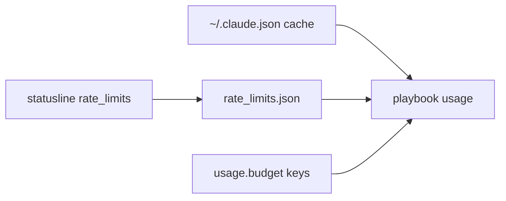
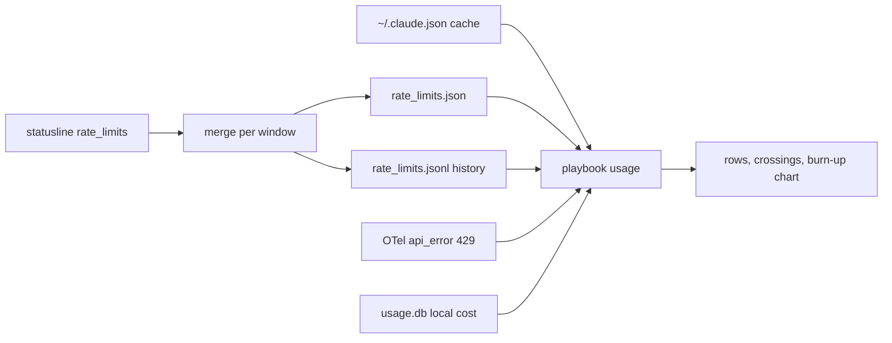

# ADR-0050: Derive Usage Limits From Claude Code's Own Data, Not the Login Token

- **Status:** Accepted
- **Date created:** 2026-10-20
- **Date modified:** 2026-10-20
- **Supersedes:** [ADR 0049](0049-spend-limit-credential-access.md), which chose to read the Claude Code login token and call the usage endpoint.
- **Builds on:** [ADR 0018](0018-tls-platform-verifier-not-adopted.md), which kept GitHub as the only network host.

## Context

`playbook usage` estimates cost from session transcripts and wants to show the limit that applies to the account, how fast it is being used, and when 50, 80 and 100 percent are or will be crossed. ADR 0049 chose to get the server figure by reading the OAuth token of Claude Code and calling `GET /api/oauth/usage`. None of that shipped: the code lived in open pull requests, and only the record itself reached `main` (#1238).

The maintainer changed the requirement on 2026-10-20. Every account has a limit: Pro, Max 5x and Max 20x have caps on 5 hour and 7 day windows, and an enterprise plan has a dollar limit. So the dashboard must not need a setting to define the plan or the limit. It must use what Claude Code and its telemetry already show and do the calculations itself.

Token free sources that exist today:

- The statusline input carries `rate_limits` (`five_hour`, `seven_day`, and behind a gateway `spend_limit`). `crates/cli/src/statusline/mod.rs` stores it through `limits_source::remember` in `<data>/rate_limits.json`. On the maintainer's Max 20x machine the file held both windows on 2026-10-20.
- Claude Code caches `cachedUsageUtilization` in `~/.claude.json`, which `crates/telemetry/src/plan.rs` reads. It was absent on that machine. The shape of its `spend` block has not been seen on an enterprise machine.
- OTel `api_error` events with `status_code`, kept in `telemetry_errors`. A 429 is the only token free proof that a cap was hit.
- `usage.db` holds the local cost per request.

The one number found in no token free source is the enterprise dollar cap and the amount the server billed against it, in case neither the statusline `spend_limit` nor the cache `spend` block carries it. That has not been checked on an enterprise machine.

## Decision Drivers

- The user does not set the limit, so there is no plan or limit key.
- Reading another application's credential is hard to take back in terms of trust, and it ships in a distributed binary.
- The reply of the usage endpoint is undocumented, and the probe saw one account type only.
- The burn rate, projection and crossings are plain arithmetic on a percent and a reset time, so they need no extra number.

## Considered Alternatives

### Keep the token fetch of ADR 0049 (effort: L)
- Read the token, call the endpoint, cache the answer, add `usage spend enable`, `usage.spend.*` keys and a consent state.
- Trade-offs: gives the server billed figure for every plan. It adds a credential path, a terms of service risk, a second network host, a consent flow and about 2,400 lines that the data sources above make unnecessary for window plans.

### Token free sources only, with the calculations in the dashboard (effort: M)
- Read the statusline reading and the Claude Code cache, derive burn rate, projection and crossings, draw a burn-up chart with a projection line and cutoff lines, and keep a bounded history of window readings.
- Trade-offs: no credential and no network. The enterprise dollar cap is shown only if a source carries it.

### Token free sources plus a fetch only for the enterprise dollar cap (effort: L)
- The same as above, with the fetch kept for the one missing number.
- Trade-offs: keeps all the credential risk to cover one unverified gap. It can be decided later, with evidence.

### A user set plan and limit (effort: S)
- Keys such as `usage.plan` and a dollar limit that the user fills in.
- Trade-offs: simple, but it breaks the requirement that the user does not set the limit, and a wrong value gives a wrong chart.

## Decision

1. Playbook does not read the Claude Code login token and does not call the Anthropic usage endpoint, in code, tests or manual runs. A test fails if a product source names the API host, and a second test fails if the telemetry crate gains an HTTP client or the cli crate gains one besides `ureq`.
2. Limits come from the statusline `rate_limits`, the `cachedUsageUtilization` cache, OTel 429 events and the local history. The display follows the fields present, not a plan name.
3. There is no `usage spend` subcommand, no `usage.plan` key and no `usage.spend.*` key. `usage.budget.monthlyUsd` and `usage.budget.weeklyUsd` stay, and are the only way to get a limit line for a login that has no Claude limit data (API key, Bedrock, Vertex, Foundry).
4. Burn rate, projection, the 50, 80 and 100 percent crossings and the burn-up chart with a projection line and cutoff lines are computed in the usage dashboard.
5. A statusline reading that carries one window keeps the other as stored, with its own read time. A bounded history file `rate_limits.jsonl` (256 KiB, 8 days) gives the window chart a time series. Without it the window chart is a straight line from the window start to the latest reading.
6. The fetch is reopened only as a new plan with its own decision, and only if the enterprise dollar cap is in neither the statusline `spend_limit` nor the cache `spend` block. The check costs nothing: `playbook usage doctor --raw` on that machine.

Why each alternative was rejected:

- The fetch of ADR 0049: it carries a credential path, a terms of service risk and a consent flow that the free sources make unnecessary for the window plans, and its endpoint reply is undocumented.
- The enterprise only fetch: it keeps the same credential risk to cover one gap that nobody has measured yet. The check in decision 6 comes first.
- The user set plan and limit: it breaks the requirement that the user does not set the limit, and a wrong value draws a wrong chart.

## Consequences

- Max and Pro users see their windows only after a session with the playbook statusline, and the dashboard says so in one line per missing case (`no-reading`, `stale`, `cap-unknown`, `windows-reset`).
- An enterprise dollar plan shows its limit only if a source carries it. Until that is checked, the row says the cap is not reported and the local spend and burn are still shown. This gap is accepted, not hidden.
- The undocumented cache fields can change. Parsing is tolerant and absent means unknown.
- No new dependency, key, command, hook or migration. The only new file in the data folder is `rate_limits.jsonl`, which can be removed without losing anything else.
- The shape of the `spend` block in the cache is unverified end to end until a real one is seen.

## Architecture Diagrams

Current state in `main` before this record:

Proposed state:

