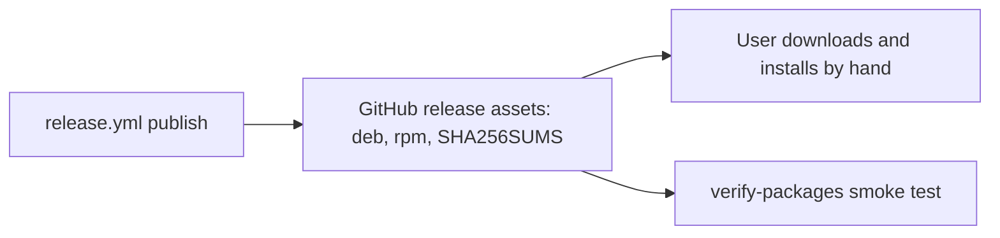
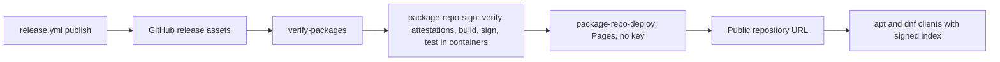

# ADR-0052: Signed apt and dnf Package Repository

- **Status:** Proposed
- **Date created:** 2026-10-22
- **Date modified:** 2026-10-22
- **Builds on:** [ADR 0039](0039-release-workflow.md), which defines the release workflow and its leaf jobs.

This record is a proposal. The maintainer approved the plan for issue #1145 but has not answered decisions D1 to D9. Each decision below marks the proposed option. Accept the record as it stands, or change any decision in review before the first line of repository code lands.

## Context

Since v0.39.0 the release ships four Linux packages: `playbook_0.39.0_amd64.deb`, `playbook_0.39.0_arm64.deb`, `playbook-0.39.0.x86_64.rpm` and `playbook-0.39.0.aarch64.rpm`, about 7 MB each (#1144). A user installs one with `apt install ./playbook_X.Y.Z_amd64.deb`. An installed package does not update itself, because no repository lists it.

Facts that shape the decision:

- File names come from `scripts/package-linux.sh`. The `publish` job requires exactly 18 assets and attests each one in `.github/workflows/release.yml`.
- The `verify-packages` job in `release.yml` is the model for a leaf job. It checks `SHA256SUMS` with `gh attestation verify`, then runs `scripts/package-smoke.sh`, which pins Debian 12, Ubuntu 24.04 and Fedora 42 by digest.
- The packages have no dependencies, run no scripts, and own no file under `/etc` or the home directory (`scripts/nfpm.yaml`). They are not signed one by one. `docs/guides/00-install.md` says `SHA256SUMS` is not signed.
- GitHub Pages is not enabled for the repository (`gh api repos/pragmatic-engineer/playbook/pages` returns 404). No signing key exists.

The only gain of a repository over the manual install is automatic upgrades. The cost is permanent: a signing key to keep and rotate, and a public URL that users write into `sources.list` and `.repo` files.

## Decision Drivers

- The release must stay free of manual steps and must not block other channels, so the repository is built by leaf jobs in `release.yml` and can be rerun with `-f version=X.Y.Z`.
- Every package in the repository must be byte identical to the attested release asset.
- The private signing key must not reach a job that has other permissions.
- The URL and the key are promises to users that are costly to break. These are the hard to reverse parts.
- Project size is small: 4 files of 7 MB per release, so about 150 MB for 5 releases.

## Considered Alternatives

### Status quo: manual `.deb` and `.rpm` download (effort: S, already shipped)
- Users download a package from the release page and install it by hand.
- Trade-offs: no key, no URL, nothing to maintain. No automatic upgrades.

### Signed repository on GitHub Pages, rebuilt each release (effort: L)
- Leaf jobs rebuild the whole repository from the last N attested releases, sign the index, and deploy to Pages. One job holds the key, a separate job deploys.
- Trade-offs: no extra account and no second repository. The URL is tied to GitHub unless a custom domain is used. The Pages deploy and the egress allowlist are unproven until the first real run.

### Self hosted bucket (Cloudflare R2 or S3) with a custom domain (effort: L)
- Same builder, deployed to object storage behind a domain the project owns.
- Trade-offs: the host can change later without breaking users. It needs an account, a second set of credentials and a domain.

### Vendor host (Cloudsmith, packagecloud) (effort: M)
- Upload packages and let the vendor build and sign the index.
- Trade-offs: least code. Package custody or the key moves to a vendor, and the plan lists vendors as a non-goal.

## Decision

Proposed: build a signed stable only apt and dnf repository, rebuilt statelessly on every release from the last N attested assets, using `apt-ftparchive`, `createrepo_c` and `gpg` on the runner. The status quo is rejected because it leaves installs without upgrades. The bucket and vendor options are rejected as the default for cost and custody, but remain open under D1 and D2.

Fixed by the plan, open to overrule in review: stable channel only; no per package signing (re-signing would change attested bytes, and apt `InRelease` plus rpm `repo_gpgcheck=1` cover every artifact); RSA 4096 with an offline primary and a signing subkey, because ed25519 on the oldest supported distros is unverified; key stored as secrets of environment `package-repo`, limited to `main`; a sign job that holds the key and a deploy job that holds Pages permissions and no key; a missing secret fails the run.

### Decisions D1 to D9

The option marked **Proposed** is the plan's recommendation. Items marked **Hard to reverse** cannot be changed later without breaking installed clients or the trust users placed in a key.

| # | Decision | Proposed | Alternatives and trade-offs | Reversibility |
|---|---|---|---|---|
| D1 | Hosting | **Proposed:** GitHub Pages from this repository. No account or credential, free at this size, under the 1 GB soft limit. | R2 or S3 with a domain: portable but needs an account and a domain. Vendor: moves custody away. | **Hard to reverse** unless D2 uses a custom domain |
| D2 | Public URL | **Proposed:** a custom domain such as `packages.<domain>` if one exists. | `https://pragmatic-engineer.github.io/playbook/`: simplest, but it cannot move host without breaking every `sources.list` entry. | **Hard to reverse.** The URL is a long lived promise |
| D3 | Signing key custody | **Proposed:** one named owner plus one backup. Primary on an offline hardware token or encrypted media, with a second copy. Secrets readable by those two people only. | Single owner: less coordination, a bus factor of one. Shared CI held primary: easy, but a CI leak ends the key. | **Hard to reverse.** Users trust a fingerprint |
| D4 | Rotation and expiry | **Proposed:** subkey lifetime 3 years, warn under 90 days, fail under 30. Rotate one year before expiry in practice. | Shorter lifetime: more rotation work and client churn. Longer: larger blast radius on leak. | Reversible by rotation |
| D5 | rpm trust model | **Proposed:** `repo_gpgcheck=1`, `gpgcheck=0`. | Sign each `.rpm` in the build job: needs a private key in a build job and changes attested bytes. | Reversible, but client `.repo` files must change |
| D6 | Repo layout | **Proposed:** flat, `apt/dists/stable`, one suite for all distros. Packages are static and distro independent. | Per codename suites: more paths, no real gain for static binaries. | Hard to change once users pin a suite |
| D7 | Retention | **Proposed:** the last 5 stable releases that carry packages. Older versions leave the index; files stay on the GitHub release. | Keep all: repository grows without bound. Keep 1: no downgrade path. | Reversible |
| D8 | Yank process | **Proposed:** a PR adds the version to `packaging/apt/yanked.txt`, then the repo job is rerun on the newest version. | Manual redeploy of an older Pages deployment: faster, no review trail. | Reversible |
| D9 | Pages and environments | **Proposed:** the maintainer enables Pages (source GitHub Actions) and creates environments `package-repo` and `github-pages`. | None. The agent that implements the code does not create environments or secrets. | Reversible, but needs maintainer rights |

## Consequences

- If accepted as proposed, the project owns a long lived signing key and a public URL. Losing the key or changing the URL breaks installed clients.
- Users get `apt install playbook`, `dnf install playbook` and normal upgrades. Docs tell them the key fingerprint, how to rotate the key on the client, and that `SHA256SUMS` itself stays unsigned.
- Other channels are unaffected: the new jobs are leaves and fail closed. A red run is rerun with `gh workflow run release.yml -f version=X.Y.Z`.
- Key compromise path: revoke the subkey, publish a new key and an advisory, rotate both secrets, rebuild. Users who pinned the old key must fetch the new one.
- A yanked version needs a PR and a rerun. A rerun alone does not remove a bad release.
- Open and unverified until the first real run: the Pages egress hosts, whether harden-runner block mode covers container traffic, `deploy-pages` environment handling, and fixed time signing for byte identical reruns. The first repository release also ships without upgrade test coverage, since only one packaged release exists.
- Follow up work, after the maintainer answers: S1 builder and tests, S2 sign and deploy jobs, S3 docs, as in the plan for #1145. This record adds no code and no key.

## Architecture Diagrams

Current state:

Proposed state:

