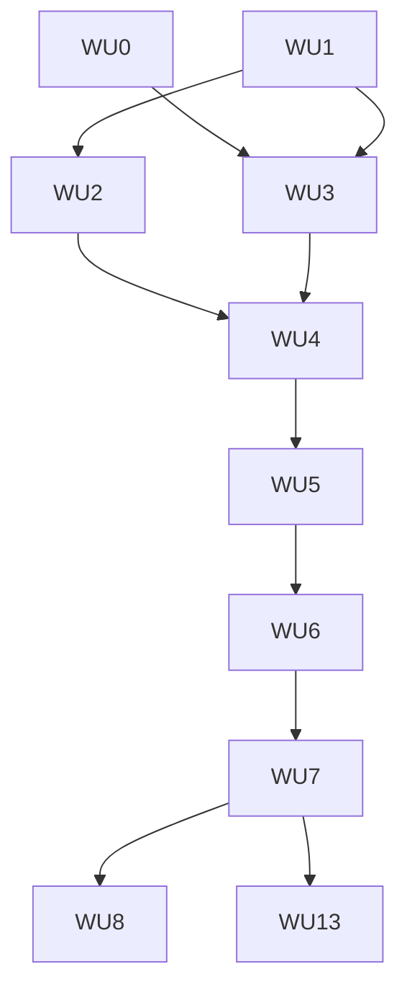

# ADR-0055 Execution Blueprint

- **Parent ADR:** `docs/adr/0055-watch-mode-for-github-events.md`

The ADR decides S1 to S5. The Work Units for S1 to S5 are specified in full below. S6 to S12 are direction: their Work Units are short and get a full brief when picked up.

## System Snapshot

Existing code the work attaches to (checked at `origin/main` `e6da2cc9`):

- `crates/cli/src/lib.rs`: `pub mod sessions;` at line 100 and the `Command` enum, where `Sessions { sub, json }` sits at line 720. A new `Watch` variant goes next to it.
- `crates/cli/src/main.rs`: the dispatch, for example `Command::Sessions { sub, json } =>` at line 957.
- `crates/cli/src/parse.rs`: the argument to `Command` mapping (`Command::Sessions {` at line 286).
- `crates/cli/src/command_index.rs`: the table behind `playbook commands` (`ro("sessions")` at line 330). Each `watch` verb gets a row with its access class.
- `crates/cli/src/config/keys.rs`: known keys, `USER_KEYS` (line 122, global tier only), and the dynamic family check `is_effort_component_key` (line 144). `watch.rule.<id>` gets the same kind of check.
- `crates/cli/src/hooks/auto_cost.rs` (comment at lines 21 and 22): the auto mode guard that denies the model changing `mode`, `auto.*` and `fix.*`. `watch.*` joins that list.
- `crates/cli/src/pr/triage.rs`: `TriageRunner`, `ClaudeRunner`, `RUNS`, `CLOSE_TAG`, `SCHEMA`. The model decide path reuses its calling pattern.
- `crates/cli/src/pr/shared.rs`: `gh`, `GhClient`, `GH_TIMEOUT`.
- `crates/cli/src/update/download.rs`: the existing `ureq::Agent` builder.
- `crates/telemetry/src/lib.rs:142`: the `UsageSource` trait, the shape the new `EventSource` copies.
- `crates/code/src/index.rs:564`: `File::try_lock` with `TryLockError::WouldBlock`.
- `crates/common/src/atomic.rs`: `with_dir_lock` (not used here) and the atomic file write helpers.
- `crates/cli/src/service_manager.rs`: the `Manager` trait, `System`, `Refuses` pattern for a fake service tool.
- `crates/cli/tests/help_lint.rs`, `crates/cli/tests/golden/flags.txt`, `crates/cli/tests/flags_snapshot.rs`: the help lint and the flag snapshot every new command must pass.
- `docs/reference/config-keys.md`, `docs/reference/commands.md`, `docs/README.md`, `docs/internals/11-data-folder.md`: docs that change per Segment.

## Rust design

Every item below is new. Paths are under `crates/cli/src/watch/`.

### Module layout

| File | Holds |
|---|---|
| `mod.rs` | `run(cmd: WatchCommand) -> ExitCode`. Dispatch only. |
| `rule.rs` | `Rule`, `On`, `Where`, `Do`, `Decide`, `Autonomy`, `Limits`, and the tombstone form. Parse and validate from JSON. |
| `settings.rs` | `Settings` (the `watch.*` keys), `resolve_rules(tiers)`, and `ceiling(tiers)` (lowest value across tiers). |
| `event.rs` | `Event`, `EventKind`, `EventKey`, `Author`, `Trust`. |
| `source.rs` | `trait EventSource`, `Poll`, `Cursor`, `SourceError`. |
| `github.rs` | `GithubPoller` (the only source in this ADR), `trait Http` with `UreqHttp`, `trait GithubWrite` with `GhWrite`, ETag and rate limit parsing, and the PR probes. |
| `store.rs` | `Store` over `data/watch.db`: tables `cursor`, `probe`, `seen`, `work` in S2. `counter` and `control` are added in WU-5, where they are first read. Schema versions. |
| `lock.rs` | `InstanceLock` over `data/watch.lock`. |
| `decide.rs` | `trait Decider`, `RulesDecider`, `ModelDecider` (three calls, unanimous). |
| `action.rs` | `trait Action`, `ActionCtx`, `Outcome`, and one file per action under `actions/`. |
| `runner.rs` | Claims work, enforces limits, the ladder and the kill switch, calls `Action`, writes the journal. |
| `child.rs` | `trait Spawner`, `OsSpawner`: starts a child in its own process group and kills the group. |
| `journal.rs` | Step records and `recover()` at start. |
| `backoff.rs` | `Backoff` over `trait Jitter`, with `StdJitter` from `std::hash::RandomState`. |
| `limits.rs` | `Limits`, `Counters`, the per-object cap, `Ladder::eligible(class)`, day roll at 00:00 UTC. |
| `clock.rs` | `trait Clock`, `SystemClock`. Every time read goes through it. |
| `audit.rs` | `AuditLog` writer with rotation and control character removal. |
| `text.rs` | `TextLoader` trait and `EventText` loader. A spy counts loads in tests. |
| `trust.rs` | `Trust` classification, the context author check, the untrusted block (`wrap_untrusted`, close tag defusing). |
| `service.rs` | launchd and systemd timer text and install (S11). |

### Types

```rust
pub struct EventKey(String); // "<source>:<object id>:<kind>[:<sha>]", built once per event

pub struct Event {
    pub key: EventKey,
    pub repo: RepoId,           // owner and name, interned per run
    pub kind: EventKind,        // closed enum
    pub author: Author,         // login and association
    pub object: u64,            // issue, PR or comment number
    pub updated_at: i64,        // epoch seconds
    pub body_hash: [u8; 32],    // sha2, already a dependency
    pub fields: EventFields,    // labels, paths, base, comment prefix (metadata only)
}
// Event text is kept apart: `EventText { title: String, body: String }`, loaded only
// by an action that is allowed to read it, with its `Trust` class checked first.

pub enum Autonomy { Off, Propose, Auto }          // Ord: Off < Propose < Auto
pub enum Trust { Trusted, Untrusted, SelfAuthored }
pub struct Cursor { since: i64, etag_url: Option<Box<str>>, etag: Option<Box<str>>, next_poll_at: i64 }

pub enum Poll { Unchanged { next_in: Duration }, Events { next: Cursor, next_in: Duration } }
```

### The source trait

```rust
pub trait EventSource {
    fn name(&self) -> &str;
    fn poll(&mut self, cursor: &Cursor, out: &mut Vec<Event>) -> Result<Poll, SourceError>;
}
```

`out` belongs to the caller. The caller clears it and keeps its capacity across polls. `GithubPoller` reuses one `Vec<u8>` body buffer and parses into borrowed structs from it, so a poll that returns 304 allocates nothing and a poll that returns events allocates only the keys it keeps. Response bodies are read with a hard limit of 4 MiB. A page is at most 100 items.

### Error handling

One enum per layer, no `String` errors across module lines, no `unwrap` or `expect` outside tests (the CI step that enforces it):

```rust
pub enum SourceError {
    RateLimited { retry_at: i64 },   // from retry-after or x-ratelimit-reset
    Unauthorized,                    // stops the loop, audited, not retried
    Transient(String),               // network, 5xx: backoff
    Malformed(String),               // bad JSON: dead letter, cursor not advanced
}
pub enum ActionError { Precondition(String), Limit(LimitKind), Killed, Unsupported, Failed { retryable: bool, why: String } }
```

`Precondition` means the world changed (issue closed, body hash changed): the item is `done` with outcome `skipped`, not retried. `Limit` demotes to `propose`. `Killed` rolls back. `Failed { retryable: true }` takes a backoff step. The loop does not exit on an error from one source or one item.

### Test seams

Every side effect sits behind a trait the tests replace: `Http` (GitHub reads), `GithubWrite` (GitHub writes, with a spy that records calls), `TextLoader` (loads `EventText`, with a spy that counts loads), `Spawner` (children), `Clock`, `Jitter`, and the service `Manager`. Each test that touches the store, the lock or the audit log injects its own temporary data directory, so parallel tests share no file. No test reaches the network, a real `claude`, a real `launchctl` or the wall clock. Real implementations are built only in `mod.rs`, so a test cannot construct one by accident.

### Safe and low memory

- No `unsafe`. Std only for the lock (`File::try_lock`), jitter (`RandomState`), process groups (`CommandExt::process_group`) and time. No `libc` call. No pid probe. The group kill runs the `kill` program as a command.
- No new crate.
- Hot path (poll, parse, key, dedupe): reused buffers, prepared SQLite statements cached on `Store`, keys hashed into the `seen` lookup with a stack buffer, no per-event `Vec`.
- The queue is bounded at 500 pending. A page is bounded at 100 items and 4 MiB. Probes are bounded at 20 per poll. Idle cost is the open database and one buffer.
- No stale code: every key, table and function in a Segment is used in that Segment or its tests. A key lands with the first Work Unit that reads it.
- Windows builds the module. Actions that need a worktree and a process group return `Unsupported` there.

## Work Units

### WU-0: Spike, record real GitHub responses (S2)
- Requires: nothing
- Goal: settle which endpoints give an `ETag`, accept `since` and ascending order, and whether a push changes a PR's `updated_at` on the issues list.
- Files: `crates/cli/tests/fixtures/watch/*.json` and `*.headers` (new, recorded from the public repo `pragmatic-engineer/playbook`, read only, logins replaced by `user-1`, `user-2`). The file names carry the endpoint.
- Changes: run `gh api -i` for `issues`, `issues/comments`, `pulls/comments` with `since`, `sort=updated`, `direction=asc`, `per_page=2`, then again with `If-None-Match`. Run it for `pulls/{n}/reviews` and `commits/{sha}/check-runs` for one merged PR. Save the status line, `etag`, `x-poll-interval`, `x-ratelimit-*`, `link` and a trimmed body.
- Verification: `ETAG=$(sed -n 's/^[Ee][Tt]ag: //p' crates/cli/tests/fixtures/watch/issues.200.headers | tr -d '\r'); gh api -i -H "If-None-Match: $ETAG" 'repos/pragmatic-engineer/playbook/issues?since=2026-10-01T00:00:00Z&sort=updated&direction=asc&per_page=2' | head -1`
- Tests: none. Fixtures feed WU-3.
- Done When:
  - [ ] The three list endpoints each have a saved 200 and a saved 304 fixture, or the PR amends the ADR with the endpoint that failed and the replacement.
  - [ ] The PR description states whether a push moves a PR's `updated_at` on the issues list.

### WU-1: Rules and settings (S2)
- Requires: nothing
- Goal: `watch.*` keys and `watch.rule.<id>` parse and resolve, with unknown fields rejected, a tombstone form, and the ceiling taken across tiers.
- Files: `crates/cli/src/config/keys.rs` (edit: keys, `is_watch_rule_key`, `USER_KEYS`), `crates/cli/src/watch/mod.rs`, `rule.rs`, `settings.rs` (new), `crates/cli/src/lib.rs` (`pub mod watch;`), `docs/reference/config-keys.md` (edit)
- Verification: `cargo test -p playbook-cli watch::rule` then `cargo test -p playbook-cli watch::settings` then `cargo test -p playbook-cli config::keys`
- Tests (TDD cycles):
  - Given a valid rule JSON, `Rule::parse` returns the typed rule.
  - Given a rule object stored through `config set` and read through `config get`, the same object comes back (round trip test).
  - Given an unknown field, parse fails.
  - Given a bad `on`, parse fails.
  - Given `autonomy` outside the three values, parse fails.
  - Given `playbook config set watch.rule.x` with an invalid body, nothing is stored.
  - Given a rule id with an uppercase letter, the key is refused.
  - Given a repo tier rule and a global rule of the same id, `resolve_rules` returns the repo rule whole.
  - Given the repo tier holds `{"autonomy":"off"}`, the rule is absent for that repo and present for others.
  - Given `{"autonomy":"off","do":"label"}`, parse fails (the tombstone is the short form only).
  - Given global `watch.autonomy = propose` and repo `auto`, the ceiling is `propose`.
  - Given global `auto` and repo `propose`, the ceiling is `propose`.
  - Given no tier sets `watch.autonomy`, the ceiling is `propose`.
  - Given the global tier unset and the repo tier `auto`, the ceiling is `auto` (a repo may opt itself up).
  - Given a rule at `auto` before WU-5, the rule check refuses it with `auto is not available yet`.
  - Given a rule at `auto` and a ceiling of `propose`, the effective level is `propose`.
- Done When:
  - [ ] `watch.rule.<id>` stores and returns a JSON object. If the config store holds only scalars and lists, this Work Unit adds object support with its own test.
  - [ ] Only keys read in S2 land here: `watch.enabled`, `watch.repos`, `watch.autonomy`, `watch.pollSeconds`, `watch.maxCatchupHours`, `watch.allowedAuthors`, `watch.tokenEnv` and the rule family. `watch.limits.*` land in WU-5, where they are first read.
  - [ ] `auto` is refused by the rule check until WU-5 lifts it.

### WU-2: Store, lock, audit, clock (S2)
- Requires: WU-1
- Goal: a crash-safe `watch.db`, an instance lock, an audit writer, and the clock seam.
- Files: `crates/cli/src/watch/store.rs`, `lock.rs`, `audit.rs`, `clock.rs` (new), `docs/internals/11-data-folder.md` (edit)
- Verification: `cargo test -p playbook-cli watch::store` then `cargo test -p playbook-cli watch::lock` then `cargo test -p playbook-cli watch::audit`
- Tests:
  - Given a held lock, a second `InstanceLock::acquire` returns `Busy` without waiting.
  - Given a lock file left by a killed process (file present, no lock held), `acquire` succeeds.
  - Given a cursor write and an event insert in one transaction that is aborted midway, neither row exists after reopen.
  - Given the same `EventKey` twice, the second insert reports `Duplicate`.
  - Given a store with a schema version newer than the code knows, `open` refuses with a clear error.
  - Given a new store, the database file has mode 0600 and the data folder keeps 0700 (Unix).
  - Given an audit file of 10 MiB minus one byte plus a small write, it rotates only when the write passes 10 MiB (cases: just under, exactly at, just over).
  - Given 6 rotations, 5 files remain.
  - Given a title with `\x1b[31m`, the audit line holds no control character.
  - Given a pending queue of 500, the 501st insert goes to `dead` with reason `queue_full`.
  - Given the sources of `watch/`, a test scans them and finds no `SystemTime::now` or `Instant::now` outside `clock.rs`.
- Done When:
  - [ ] The scan test above passes.

### WU-3: GitHub poller and probes (S2)
- Requires: WU-0, WU-1
- Goal: `GithubPoller` implements `EventSource` over a fake `Http`, with ETag, `since`, `X-Poll-Interval`, rate limit handling and PR probes.
- Files: `crates/cli/src/watch/source.rs`, `github.rs`, `event.rs` (new)
- Verification: `cargo test -p playbook-cli watch::github`
- Tests:
  - Given the 304 fixture, `poll` returns `Unchanged` and `out` stays empty.
  - Given the 200 fixture, `poll` fills `out` in ascending order.
  - Given the 200 fixture, `since` moves to the last `updated_at`.
  - Given an empty page, `poll` returns `Unchanged` and the cursor is unchanged.
  - Given a full page of 100 items with a `Link: rel="next"`, the next page is read.
  - Given 11 pages, only 10 are read and the cursor stops at the last full page.
  - Given a body of exactly 4 MiB, it is read. Given one byte more, the read stops with `Malformed`.
  - Given `x-ratelimit-remaining: 0` and a reset time, `poll` returns `RateLimited` with that time.
  - Given `retry-after: 30`, the next call is at least 30 seconds out (table: 0, 30, 3600).
  - Given `X-Poll-Interval: 120` and `watch.pollSeconds = 60`, the next call waits 120 seconds.
  - Given `X-Poll-Interval: 30` and `watch.pollSeconds = 60`, it waits 60.
  - Given malformed JSON, `poll` returns `Malformed`, the cursor is not advanced and the page goes to the dead letter list.
  - Given a comment whose body hash changed since first sight, no new event is produced.
  - Given a PR updated twice with different head SHAs, two `pr.updated` events with different keys are produced.
  - Given 20 updated PRs and a rule that needs checks, all 20 probes run.
  - Given 21 updated PRs, 20 probes run and 1 waits for the next poll.
  - Given a token string, no log line or error text contains it.
  - Given the 304 path, the reused buffers do not grow (capacity before equals capacity after).
  - Given the sources of `watch/`, a test scans them and finds `UreqHttp::new` nowhere outside `mod.rs`.
- Done When:
  - [ ] Tests use the fake `Http` only, and the scan test above passes.

### WU-4: `watch once`, `dry-run` and the first rule (S2)
- Requires: WU-1, WU-2, WU-3
- Goal: `playbook watch once` and `playbook watch dry-run` run end to end for the rule that labels a new issue.
- Files: `crates/cli/src/watch/mod.rs`, `action.rs`, `actions/label.rs`, `decide.rs`, `trust.rs`, `text.rs` (the `TextLoader` trait and its spy), `runner.rs` (minimal) (new), `crates/cli/src/lib.rs` (edit: `Watch` variant), `crates/cli/src/main.rs` (edit), `crates/cli/src/parse.rs` (edit), `crates/cli/src/command_index.rs` (edit), `crates/cli/tests/golden/flags.txt` (edit), `docs/reference/commands.md` (edit), `docs/README.md` (edit)
- Verification: `cargo test -p playbook-cli watch::` then `cargo test -p playbook-cli --test help_lint` then `cargo test -p playbook-cli --test flags_snapshot`
- Tests (Gherkin, with a `GithubWrite` spy):
  - Given a `label` rule at `propose` and a new issue, when `watch once` runs, a proposal row exists and its id is printed.
  - Given that run, the spy saw no write.
  - Given `approve <id>` on that proposal with the lock free, the spy saw one label call carrying the label name and the issue number.
  - Given the same label already present (marker found), a repeated `approve` adds no call.
  - Given an `approved` row and a later `watch once` that holds the lock, the action runs once.
  - Given `dry-run`, the output lists the rule and the action.
  - Given `dry-run`, the database is unchanged and the spy saw no write.
  - Given an issue from a stranger, the label rule still runs.
  - Given an issue from a stranger, the `TextLoader` spy records zero loads.
  - Given the body hash changes between queueing and action, the action is skipped and the spy saw no write.
  - Given a gap of exactly `watch.maxCatchupHours`, the events at the boundary are processed.
  - Given a gap of one second more, older events are audited as `stale` and skipped.
  - Given a run with three decisions, the audit log holds exactly three lines, each with the rule id and outcome.
  - Given a comment from a stranger with the prefix `/playbook merge`, a `comment_prefix` rule ignores it.
  - Given the same comment from a trusted author, the rule matches and queues the `label` action.
  - Given a comment under your own login with no prefix match, no rule runs (self class).
  - Given a comment carrying the hidden marker, no rule runs.
  - Given a token in the environment, no audit line contains it.
  - Given a token in the environment, no printed output or error text contains it.
  - Given a second `InstanceLock` handle held in the same test, `watch once` prints `watch already running` and exits 0.
  - Given the first run on a repo, the cursor starts at now and no backlog is queued.
  - Given `--since`, the backlog from that time is processed.
  - Given `watch.enabled = false`, `once` does nothing and says so.
  - Given `approve` while a second handle holds the lock, the row becomes `approved`.
  - Given that `approve`, the spy saw no write in this process.
  - Given `approve` while the lock is free, the row becomes `done`.
  - Given `reject`, the stored state is `done` and the outcome is `rejected`.
  - Given `reject`, the spy saw no write.
  - Given an issue closed between proposal and `approve`, the stored outcome is `skipped` (precondition re-read).
  - Given the sources of `watch/`, a scan test finds neither `sh -c` nor `Command::new("sh")`.
- Done When:
  - [ ] `playbook commands` lists `watch` and its verbs, and `help_lint` passes with no allowlist entry.
  - [ ] The scan test above passes.

### WU-5: Control plane, limits and the ladder (S3)
- Requires: WU-4
- Goal: `status`, `pause`, `resume`, `log`, `retry`, limits, backoff, dead letters, the ladder, the `auto` level, and the auto mode guard for `watch.*`.
- Files: `crates/cli/src/config/keys.rs` (edit: `watch.limits.*`, `USER_KEYS`), `crates/cli/src/watch/limits.rs`, `backoff.rs`, `actions/comment.rs`, `mod.rs`, `store.rs` (edit: `counter`, `control`), `runner.rs` (edit), `crates/cli/src/hooks/auto_cost.rs` (edit: protected key prefix) and its test, docs (edit)
- Verification: `cargo test -p playbook-cli watch::limits` then `cargo test -p playbook-cli watch::backoff` then `cargo test -p playbook-cli watch::runner` then `cargo test -p playbook-cli hooks::auto_cost`
- Tests:
  - One table driven test covers each of these limits: rule `actions_per_day`, rule `usd_per_day`, global `watch.limits.actionsPerDay`, global `watch.limits.usdPerDay`. Each row runs limit minus one, the limit, and limit plus one. The first two run. The third is demoted to a proposal with reason `limit`. The `files` and `lines` rows need a diff, so they live in WU-6.
  - Per object cap: a second action by the same rule on the same object at 59 minutes is demoted.
  - Per object cap: at exactly 60 minutes it runs (the cap is "one per 60 minutes").
  - Per object cap: at 61 minutes it runs.
  - Given the injected clock at 23:59:59 UTC, the counters are not reset.
  - Given the injected clock at 00:00:00 UTC, the counters are reset.
  - Given the `comment` action with fixed text, the posted text equals the rule text.
  - Given the `comment` action, the `TextLoader` spy records zero loads.
  - Given the `comment` action and the marker already present, a repeated run adds no call.
  - Given a rule at `auto` and ceiling `auto` for `label`, `watch once` applies the label once.
  - Given that run, a second `watch once` adds no call (spy).
  - Given a rule at `auto` and ceiling `propose`, the result is a proposal.
  - Given the queue holds 500 pending items, the runner path reports `queue_full` for the 501st (the store test in WU-2 covers the insert).
  - Given a `propose` item, the action counter does not change.
  - Given an approved item that runs, the action counter rises by one.
  - Given `watch pause`, no new action starts.
  - Given `watch pause` and a running action, the action finishes.
  - Given `retry` on a dead item, the stored state is `queued` and `attempts` is 0.
  - Given `retry`, the audit has a `retry` line.
  - Given a `proposed` item and `reject`, the audit has a `reject` line.
  - Given an approved item whose action fails with a retryable error, the stored state is `approved` with a later `not_before`.
  - Given `watch log` printing a title that held `\x1b[31m`, the printed text holds no control character.
  - Given `watch log --json`, every line parses as JSON.
  - Given `watch log --json`, no line holds a raw body.
  - Given 5 failed attempts, the item is `dead` and `status` lists it with the reason.
  - Attempt n (starting at 0) has the ceiling `min(cap, base * 2^n)` with base 30 s and cap 3600 s. Given 1000 trials with an injected `Jitter`, every delay is between 0 and that ceiling.
  - Given a `Jitter` fixed at its maximum, the delay of attempt n equals the ceiling, is above 0 for every n, and reaches 3600 s by attempt 7.
  - Given a `Jitter` fixed at its minimum, the delay is 0 (full jitter), and the item is still retried once `not_before` passes.
  - Ladder cases (one test each, a table is fine): 9 approved proposals over 28 days gives a demotion to `propose` with the reason in the audit. 10 over 27 days gives a demotion. 10 over 28 days with one failed gives a demotion. 10 over 28 days with none failed lets `auto` run.
  - Ladder: `label` and fixed comments run at `auto` with no history.
  - Given mode `auto`, a model call to `playbook config set watch.rule.x ...` is denied.
- Done When:
  - [ ] Every limit and every state transition in the ADR has a test above, and the `watch.limits.*` keys land here.

### WU-6: Action runner and recovery (S4)
- Requires: WU-5
- Goal: worktree based actions with a journal, a `claude -p` runner, process group handling and recovery after a kill.
- Files: `crates/cli/src/watch/child.rs`, `journal.rs`, `runner.rs`, `decide.rs` (edit: `ModelDecider`), `trust.rs` (edit), `actions/` (edit), docs (edit)
- Verification: `cargo test -p playbook-cli watch::journal` then `cargo test -p playbook-cli watch::child` then `cargo test -p playbook-cli watch::decide` then `cargo test -p playbook-cli watch::trust` then `cargo test -p playbook-cli watch::runner`
- Tests (a fake `Spawner` and the injected `Clock`):
  - Given a kill after the worktree was made and before any push, `recover` removes the worktree and requeues.
  - Given a kill after the push and before the marker, `recover` finds the pushed branch, posts the marker and records `done`.
  - Given a kill at an unknown step, the item is `dead` and the worktree stays.
  - Given three model replies `quick, quick, deep`, the item is stored as `proposed`.
  - Given three replies that agree, the action proceeds.
  - Given a model reply with a label outside the rule's list, the item is stored as `proposed` with reason `invalid_reply`.
  - Given that reply, the spy saw no label call.
  - Given an unparseable model reply, the item is stored as `proposed` with the same reason.
  - Given the kill switch flips while a fake child runs, the check after the flip sends the group kill (spy assertion, no wall clock).
  - Given a running fake child and the injected clock, the runner checks the kill switch at least every 5 seconds of clock time.
  - Given a non-empty `permission_denials` in the reply, the result is a failure.
  - Given a `Failed` error with `retryable: false`, the item is `dead` at once with the reason.
  - Given a `Killed` error, the journal rolls back and the worktree is removed.
  - Given a target that is not Unix (a `cfg` seam), an action that needs a worktree returns `Unsupported` and the item is `proposed` with reason `unsupported`.
  - Given untrusted text with the close tag inside it, the prompt holds the defused tag.
  - Given a thread with one untrusted commenter, a tool-using action refuses with `untrusted context`.
  - Given a fork PR, a code-writing action refuses, and the diff is read through the API only.
  - Given the classify call, the argv holds the adjacent pair `--tools` `""`.
  - Given the classify call, the argv holds the adjacent pair `--setting-sources` `""`.
  - Given the classify call, the argv holds `--no-session-persistence` and `--strict-mcp-config`.
  - Given the classify call, the schema enum equals the rule's label list.
  - Given the classify call with a fixture title and body that carry a sentinel of at least 16 bytes, the sentinel is on stdin and in no argv element.
  - Given the group kill command is missing, the kill falls back to `Child::kill`.
  - Given the tool-using call, `--max-budget-usd` has a value equal to the rule's remaining daily dollars.
  - Given the tool-using call, the argv holds `--max-turns`.
  - Given the tool-using call, the env holds `PLAYBOOK_HEADLESS=1` and `PLAYBOOK_MODE=auto`.
  - Given the tool-using call, the argv holds neither `--bare` nor a bypass permission mode.
  - Given a reply with no cost field, the day's counter rises by the call's `--max-budget-usd`.
  - Given a reply whose cost field is 0.42, the day's counter rises by 0.42 and not by `--max-budget-usd`.
  - Given a reply that reports a cost of 0, the counter rises by 0.
  - Table driven over rule `files` and rule `lines` (each row: limit minus one, the limit, limit plus one): the first two keep the diff, the third rolls the change back and demotes it to a proposal with reason `limit`.
  - Given a diff over `fix.maxFiles` and a rule with no `files` entry, the change is rolled back (the default is `fix.maxFiles`).
- Done When:
  - [ ] Whether the reply envelope holds a cost field is checked against one real call and recorded in the PR. The no-cost test above covers the fallback.

### WU-7: Foreground loop (S5)
- Requires: WU-6
- Goal: `playbook watch` runs the loop until stopped, with catch-up after a gap.
- Files: `crates/cli/src/watch/mod.rs` (edit: `run_loop`), `crates/cli/src/lib.rs` (edit)
- Verification: `cargo test -p playbook-cli watch::run_loop`
- Tests (injected `Clock`):
  - Given a clock jump of 8 hours, the next cycle polls at once and resumes from the cursor.
  - The gap boundary cases live in WU-4 and are not repeated here.
  - Given a transient network error, the loop backs off and continues.
  - Given `Unauthorized`, the loop stops with a clear message and exit 1.
  - Given a second foreground `watch`, it prints `watch already running` and exits 1.
- Done When:
  - [ ] An acceptance run is recorded in the PR: three rules, a day, a laptop sleep, each event handled once, the audit log complete.

### S6 to S12: direction, one Work Unit each
- Requires: WU-7 (S12 needs its own ADR amendment first)
- Each Work Unit is one PR and keeps the constraints in the ADR: the ceiling table, the idempotency marker, the precondition re-read, the limits and the context author check.
- WU-8 `triage_issue`: `cargo test -p playbook-cli watch::actions::triage_issue`
- WU-9 `address_comment`: `cargo test -p playbook-cli watch::actions::address_comment`
- WU-10 `update_branch`: `cargo test -p playbook-cli watch::actions::update_branch`
- WU-11 `review_pr` (pending review, `propose` only): `cargo test -p playbook-cli watch::actions::review_pr`
- WU-12 `merge_when_green` (`propose` only, needs `autoMerge.enabled`, a human approval, green checks, an allowed author): `cargo test -p playbook-cli watch::actions::merge_when_green`
- WU-13 `install-service`: a timer that runs `watch once` every 60 seconds (launchd `StartInterval`, systemd user timer), a doctor row and an uninstall step: `cargo test -p playbook-cli watch::service`. Tests use a fake `Manager` and construct the real one nowhere. Needs the maintainer's answer to open question 2.
- Done When (WU-8 to WU-12 name these three tests in their briefs, with the rule's own name in front):
  - [ ] `<rule>_adds_one_marker_and_repeat_adds_none` (idempotency).
  - [ ] `<rule>_skips_when_the_object_changed` (precondition re-read).
  - [ ] `<rule>_never_exceeds_its_highest_level` (ceiling table).
- Done When (WU-13): a fake `Manager` test per unit text (launchd and systemd), a test that the real `Manager` is built only in `mod.rs`, and an uninstall test that removes the unit and keeps the audit log until the user confirms.

## Ordering

| WU | Requires | Parallel group |
|---|---|---|
| WU-0 | none | P1 |
| WU-1 | none | P1 |
| WU-2 | WU-1 | none |
| WU-3 | WU-0, WU-1 | none |
| WU-4 | WU-1, WU-2, WU-3 | none |
| WU-5 | WU-4 | none |
| WU-6 | WU-5 | none |
| WU-7 | WU-6 | none |
| WU-8 to WU-12 | WU-7 | none |
| WU-13 | WU-7 | none |

## Parallel Groups

- P1: WU-0 and WU-1. WU-0 writes only `crates/cli/tests/fixtures/watch/`. WU-1 writes `config/keys.rs`, `watch/mod.rs`, `rule.rs`, `settings.rs` and the config docs. The files are disjoint and neither reads the other's output.
- Sequential: everything else.

## Dependency Graph



## Segments

| Segment | Work Units | PR title |
|---|---|---|
| S1 | none | `docs(adr): add the watch mode design` |
| S2 | WU-0 to WU-4 | `feat(watch): add watch once and dry-run with polling` |
| S3 | WU-5 | `feat(watch): add status, pause, limits and the kill switch` |
| S4 | WU-6 | `feat(watch): add the action runner and recovery` |
| S5 | WU-7 | `feat(watch): add the foreground loop` |
| S6 to S10 | WU-8 to WU-12 | `feat(watch): add the <rule> rule`, one each |
| S11 | WU-13 | `feat(watch): add install-service` |
| S12 | none yet | Webhook source, after an ADR amendment |

S2 is larger than the others. If its diff passes the Segment size limit (`playbook segment size`), split it at WU-2: the first PR holds WU-0 to WU-2, the second WU-3 and WU-4.

## Confidence + open items

- Confidence: MEDIUM. The design follows code that exists and GitHub behavior read from its docs. Three assumptions are not yet proven.
- Open items (verify downstream):
  - Whether the three list endpoints return an `ETag` and honor `since` with ascending order, and whether a push moves a PR's `updated_at`. WU-0 checks it. A failure changes the source for that endpoint.
  - Whether `claude -p --output-format json` returns a cost field. The triage code reads only `is_error` and `structured_output`. WU-6 checks it, and the fallback is to charge the budget cap.
  - Whether the config store accepts a JSON object as a value. WU-1 checks it, and adds support with a test if not.
  - Whether `unsafe` is forbidden workspace-wide. The maintainer answers in the PR. This design adds none either way.
  - Whether a timer that runs `watch once` is accepted for `install-service` (ADR open question 2). The maintainer answers in the PR before WU-13.
