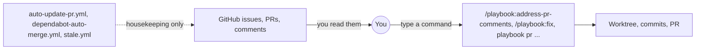
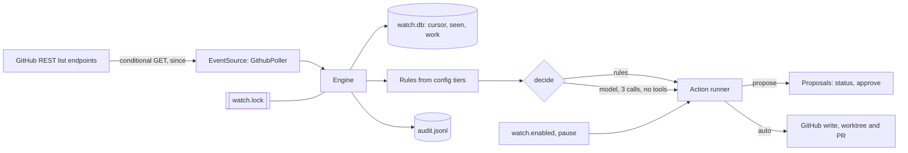
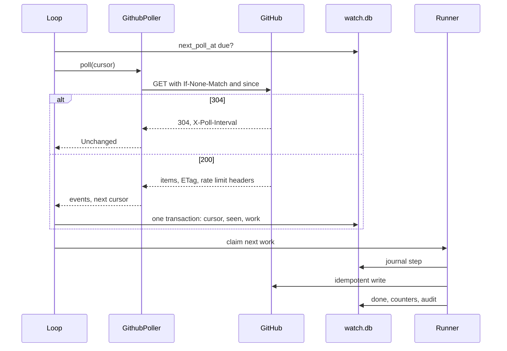
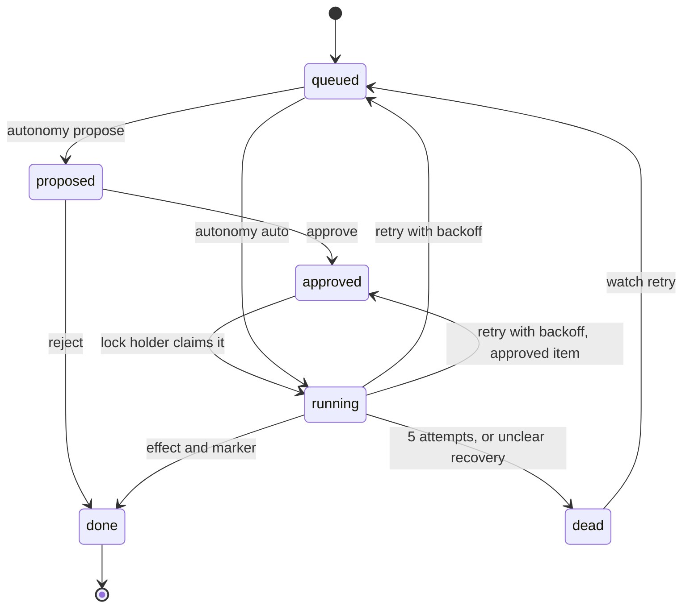

# ADR-0055: A Polling Watch Mode for GitHub Events, With Rules, Autonomy Levels and a Durable Queue

- **Status:** Proposed
- **Date created:** 2026-10-25
- **Date modified:** 2026-10-25
- **Extends:** [ADR 0025](0025-self-improving-playbook.md), for GitHub actions. ADR 0025 says a level above `propose` needs a track record and a new ADR. For `triage_issue` and `update_branch` this record replaces the new ADR step with the machine-checked ladder in decision 3, and this ADR is that approval. Learn changes keep the ADR 0025 rules unchanged.
- **Relates to:** [ADR 0025](0025-self-improving-playbook.md) (autonomy ceiling and trust ladder), [ADR 0048](0048-collector-daemon-started-by-commands.md) (the lifetime lock), [ADR 0024](0024-session-management-view-and-lifecycle.md) (a `propose` default and an `auto` that stays off until earned), [ADR 0053](0053-windows-experimental-cli.md) (Windows scope)

## Context

Issue #534 asks for `playbook watch`: a process on your machine that listens to GitHub issues, pull requests and comments, and takes an action or makes a decision for each event. It has to survive restarts, sleep, rate limits and a bad network, and each person decides what it does and how much freedom it has. The issue asks for an ADR first. This is that ADR. It builds nothing.

### What exists (checked against `origin/main` at `e6da2cc9`, version 0.39.0)

| Piece | Where | What it gives watch mode |
|---|---|---|
| Event driven CI | `.github/workflows/` | The issue says six `agent-*.yml` workflows react to events. They are gone: `ci: drop the agent workflows and turn on Dependabot updates (#1185)` removed them, and `docs/adr/0047-repo-tidy.md` records the tidy. The event driven workflows that remain (`auto-update-pr.yml`, `dependabot-auto-merge.yml`, `stale.yml`, `lock.yml`, `clanker-filter.yml`) are housekeeping. None triages or reviews, and nothing in the repo reacts to a comment. |
| Manual building blocks | `plugins/playbook/skills/`, `crates/cli/src/pr/` | `address-pr-comments`, `deep-review`, `fix`, `implement`, `pr review-triage`, `worktree sweep`. All need a person at the keyboard. |
| Review triage | `crates/cli/src/pr/triage.rs` | Three `claude -p` calls (`RUNS`), `--tools ""`, `--no-session-persistence`, `--setting-sources ""`, `--strict-mcp-config`, a JSON schema, and the untrusted text inside `<untrusted_pr_data>` with the close tag defused (`CLOSE_TAG`). Only a unanimous `quick` is quick. Any disagreement, failed call or invalid reply is `deep`. |
| The `gh` helper and client trait | `crates/cli/src/pr/shared.rs` (`gh`, `GhClient`, `RealGhClient`, `GH_TIMEOUT` of 60 s) | Calls `gh` with a timeout. It returns trimmed stdout only (no headers), so it cannot do ETag or rate limit handling. |
| HTTP client | `crates/cli/Cargo.toml` (`ureq =3.4.2`, rustls), used by `crates/cli/src/update/download.rs` | Already in the binary. No new crate is needed for headers. |
| A source behind a trait | `crates/telemetry/src/lib.rs:142` (`UsageSource`: `name`, `events_since(watermark)` with an inclusive boundary absorbed by dedupe) | The pattern the issue names for the event source. |
| Config tiers | `docs/reference/config-keys.md`, `crates/cli/src/config/keys.rs` | Repo, org and global tiers plus the default, all in `~/.config/playbook/data/config.db`. The first tier that sets a key wins. Keys are scalars or lists. Dynamic key families exist (`effort.<kind>.<name>`). Some keys count only at the global tier (`is_user_key`). |
| Limits that exist | `fix.maxFiles` (3), `fix.maxLines` (500), `autoMerge.enabled` (false), `auto.budgetUsd` (200), `auto.agentBudgetUsd` (50) | Reused. `auto.*` caps a session. Watch needs its own daily caps. |
| Auto mode rules | `docs/guides/04-auto-mode.md` (line 56), `docs/internals/05-headless-mode.md` | While auto is on, the model cannot change `mode`, `auto.*` or `fix.*`. Auto never force-pushes and never uses a forced lease. `address-pr-comments` is refused in auto because replies speak in your name. A permission denial under `claude -p` exits 0. `AskUserQuestion` does not exist under `-p`. |
| Process lock, kernel kind | `docs/adr/0048-collector-daemon-started-by-commands.md` decision 1 (`File::try_lock` on `collector.lock`), used in `crates/code/src/index.rs:564` | The OS drops the lock on any exit, so a held lock means a live holder and there is no stale state. |
| Process lock, directory kind | `crates/common/src/atomic.rs` (`with_dir_lock`, `STALE_LOCK_AGE` of 10 s), used by `crates/cli/src/hooks/memory_signals.rs` | The "memory signals lock" the issue mentions. It breaks a lock by age and runs unguarded when it cannot take it. That is right for a hook that holds a lock for milliseconds and wrong for a process that holds one for days. |
| Data and log folders | `docs/internals/11-data-folder.md` | Databases live in `~/.config/playbook/data` (mode 0700). Logs and per-session files live in `~/.config/playbook/runtime`. |
| Service files | `crates/cli/src/service_manager.rs` | Only removes the retired collector service files. [ADR 0048](0048-collector-daemon-started-by-commands.md) deleted the service because the service and the on-demand collector fought over a port and the service cost 2436 lines. |
| Command names | `playbook commands` | No `watch`, `once`, `pause` or `resume`. `status` exists under `usage`, and `log` under `effort`. A subcommand of `watch` does not clash with them. |
| unsafe code | `Cargo.toml:19` sets only `undocumented_unsafe_blocks = "warn"`. A search of `crates/**/*.rs` finds 65 lines that contain `unsafe`, and `libc` is a dependency | The rule for this work is no `unsafe`. The workspace does not yet forbid it. See the open questions. |

### What GitHub gives a poller (read from the GitHub REST docs on 2026-10-25)

- "Making a conditional request does not count against your primary rate limit if a `304` response is returned", provided the request carries an `Authorization` header.
- A `retry-after` header means no retry before that many seconds. `x-ratelimit-remaining: 0` means no request until `x-ratelimit-reset` (epoch seconds).
- For secondary limits, make requests one at a time, and wait at least one second between writes.
- The docs advise webhooks over polling, and efficient polling where webhooks are not possible.
- The repository events endpoint lists at most 300 events from the last 30 days, supports ETag, and sends `X-Poll-Interval`. Its latency "can be anywhere from 30s to 6h", and it "is not built to serve real-time use cases".

## Decision Drivers

- The tool runs on a laptop that sleeps, with no public address. A webhook needs an endpoint, and the repo has no such server (a search of `crates` for `webhook` finds no match).
- A 304 costs no primary rate limit. A well behaved poller is cheap in quota and in memory.
- The events endpoint can be 6 hours late, so it cannot be the main source for "react to a comment".
- Issue and comment text comes from strangers. `crates/cli/src/pr/triage.rs` already treats PR text as untrusted data, and the headless notes list "a model that reads untrusted pull request text with write or shell tools" as unsafe unattended.
- The repo rules for this work: no `unsafe`, low memory, no allocation in hot loops, no stale code.
- ADR 0025 kept `auto` off until a track record exists, and the maintainer asks here for `off`, `propose` and `auto` with `propose` as the default.
- Every state file must survive a kill at any instruction, because a laptop lid close or a `kill -9` gives no warning.

## Considered Alternatives

### A. Poll the GitHub REST list endpoints with conditional requests, behind a source trait (effort: L)
- A cursor per repo and per source (`issues`, `issue comments`, `review comments`, `reviews`), ETag and `since`, `X-Poll-Interval` honored, rate limit headers read. A webhook adapter can implement the same trait later.
- Trade-offs: works behind any firewall with no server. Latency is the poll interval (60 s by default), not real time. Costs a few quota-free 304 calls per minute per repo.

### B. Receive webhooks (effort: XL)
- GitHub posts each event to a public endpoint, or to a local one through a tunnel.
- Trade-offs: near real time and the lowest request count. Needs a reachable endpoint, a tunnel, a secret and signature check, and retry handling for deliveries missed while the laptop sleeps. GitHub keeps no replay queue you can rely on after sleep, so a poller is needed for catch-up anyway.

### C. Keep using GitHub Actions (effort: M)
- Workflows run `claude-code-action` on GitHub's runners on each event.
- Trade-offs: no process to keep alive. Runs on GitHub's machines with no local memory and no local auth (the issue's own list of limits), and costs runner minutes. The six workflows were removed in #1185, so this path is a rebuild, not a status quo.

### D. Poll the repository events endpoint (effort: M)
- One request per repo returns every event type, with ETag and `X-Poll-Interval`.
- Trade-offs: simplest cursor. Latency up to 6 hours by the docs and a 300 event window, so a busy repo can lose events between polls. Rejected as the main source. It stays usable as a cheap hint that something changed.

### F. Run `watch once` from cron or launchd and build no loop and no daemon (effort: S)
- Only the engine, the rules and the queue are built. A scheduler calls `once` every minute.
- Trade-offs: the least code and no resident process. It is also what S2 and S3 deliver. It is kept as the base of the design: the foreground loop (S5) and the service (S11) only call the same `once`. A loop is still wanted for people who run it in a terminal, so it is not the whole answer.

### E. Poll the notifications endpoint (effort: M)
- One request covers every repo you watch.
- Trade-offs: only events that notify you (mentions, review requests, assignments). A new issue you were not mentioned in does not appear, so the triage rule cannot work. Rejected.

## Decision

### 1. Event source: polling behind a trait (alternative A)

Watch mode polls three list endpoints per repo, sorted by `updated` ascending, with `since`: issues (this includes PRs), issue comments, and pull request review comments. Each is one source with its own cursor. Two kinds of fact have no `since` list: the reviews of a PR and its check runs. They are read as probes. When the issues source reports an updated PR, and a rule that needs reviews or checks matches it, the engine fetches that PR's reviews and check runs, at most 20 probes per poll, each with its own stored ETag. A probe is a read by object, not a cursor, so it keeps the cost of a quiet repo at three conditional calls per poll. The trait is:

```rust
pub trait EventSource {
    fn name(&self) -> &str;
    fn poll(&mut self, cursor: &Cursor, out: &mut Vec<Event>) -> Result<Poll, SourceError>;
}
```

`Poll` carries the next cursor, the minimum seconds before the next call (from `X-Poll-Interval` and `retry-after`), and `Unchanged` for a 304. `out` is cleared and reused by the caller, so a poll allocates nothing per cycle once the buffer has grown. A webhook source implements the same trait by draining a local spool, so the engine does not change. The blueprint gives the Rust design.

Reasons for the rejected options:

- Webhooks (B): need a public endpoint and still need catch-up polling after sleep. They come later, as an adapter, if polling proves too slow (the issue's step 5).
- Actions (C): off the user's machine, and removed from this repo.
- Repository events (D): latency up to 6 hours.
- Notifications (E): misses the events the first rule needs.

Conditional requests: the ETag is stored with the exact request URL, including `since`. While nothing changes the URL stays the same and GitHub answers 304. When events arrive, `since` moves, the URL changes, and the next call is a normal 200 that returns a new ETag. The HTTP client is `ureq` with the token from `gh auth token` (or the env var named by `watch.tokenEnv`), held in memory and not written to the database or the log. This part must be confirmed with recorded real responses in the first Segment (open item 1 in the blueprint): the docs say "most endpoints" return an ETag.

Event identity: `<source>:<object id>:<kind>`, for example `comment:12345:created`. Kinds that can repeat on one object carry the head commit SHA, for example `pr:77:updated:<sha>` and `pr:77:checks_green:<sha>`, so a second push is a new event and a replay of the same push is not. An edited comment is not a new event. The body hash seen first is recorded, and a later change to the body is ignored unless a rule sets `on_edit = true`, so a stranger cannot edit a comment after an approval to change what runs.

Pagination: follow `Link: rel="next"` for at most 10 pages per poll. The cursor moves to the last fully processed `updated_at`, so a long backlog drains over several polls.

The first poll of a repo starts the cursor at now. A backlog is not replayed unless you pass `--since <time>`.

### 2. Rules, and where they live

A rule is one JSON object stored in one config key, `watch.rule.<id>`, with `<id>` made of lowercase letters, digits and hyphens. This is a dynamic key family like `effort.<kind>.<name>`. A key per rule is deliberate: the config store resolves one key at a time, first tier wins, so a repo tier `watch.rule.triage-issue` replaces the global rule of the same id as a whole, and `{"autonomy":"off"}` at the repo tier switches an inherited rule off for that repo. Fields are not merged across tiers, so what runs is one complete rule you can read with `playbook config get`.

```json
{
  "on": "issue.opened",
  "where": { "labels_any": ["bug"], "authors": ["alice"], "paths": ["crates/**"], "base": "main", "comment_prefix": "/playbook" },
  "do": "label",
  "with": { "labels": ["triage"] },
  "decide": "rules",
  "autonomy": "propose",
  "limits": { "actions_per_day": 20, "usd_per_day": 0, "files": 3, "lines": 500 }
}
```

- `on` is a closed list: `issue.opened`, `issue.commented`, `pr.opened`, `pr.commented` from the three polled sources, and `pr.updated`, `pr.reviewed`, `pr.checks_green` from probes. The first four are built in S2. The probe kinds are built with the first rule that needs them.
- `do` is a closed list of actions that the binary implements. There is no field that holds a shell command or an API path. Phase one: `label`. In S3: `comment` with fixed text from the rule. Later, one per Segment: `triage_issue`, `address_comment`, `update_branch`, `review_pr`, `merge_when_green`.
- `where` filters on metadata only: label, author, path glob, base branch, and an exact comment prefix.
- Unknown fields are an error when `playbook config set` writes the rule. One short form is valid: the object `{"autonomy":"off"}` alone. It is a tombstone that switches an inherited rule of the same id off at that tier. A rule that fails validation when read is skipped and audited, and the other rules keep running.
- Which repos are watched is the global-only list `watch.repos` (`owner/name`). An org tier rule applies to every watched repo under that owner. Rules live in `config.db` under your home, not in the repo checkout, so a pull request cannot add or change a rule.

Config keys added (all documented in `docs/reference/config-keys.md` when each lands):

| Key | Default | Tier | Meaning |
|---|---|---|---|
| `watch.enabled` | `false` | global only | Kill switch and opt in. `false` stops every action at the next check. |
| `watch.repos` | empty | global only | `owner/name` list to poll. |
| `watch.autonomy` | `propose` | global, org, repo | Ceiling for every rule. Unlike other keys, the tiers do not override each other: the value in force is the lowest set in any tier, and `propose` when no tier sets it. A repo cannot raise what the global tier lowered, and a repo may opt itself up when the global tier is unset. A rule's effective level is the lowest of its own level and that ceiling. |
| `watch.pollSeconds` | `60` | global only | Least seconds between polls of one source. `X-Poll-Interval` can raise it and cannot lower it. |
| `watch.maxCatchupHours` | `72` | global only | Events older than this after a gap are skipped and audited as `stale`. |
| `watch.allowedAuthors` | empty | global, org, repo | Extra logins whose text may reach a tool-using model. The authenticated user is allowed without an entry. |
| `watch.tokenEnv` | empty | global only | Name of an env var that holds a narrower token. The token is not stored. |
| `watch.limits.actionsPerDay` | `50` | global only | Total auto actions per UTC day, all rules. |
| `watch.limits.usdPerDay` | `5` | global only | Total model spend per UTC day, all rules. |
| `watch.rule.<id>` | none | any | One rule. |

While `mode` is `auto`, the model must not change `watch.*` keys, the same protection that covers `mode`, `auto.*` and `fix.*` today. A model must not be able to widen its own rules.

### 3. Autonomy per rule

| Level | Meaning |
|---|---|
| `off` | The rule is not matched. |
| `propose` (default) | The rule runs up to the point of effect. The result is saved as a proposal in the local queue and printed by `watch status`. Nothing is written to GitHub, except where the proposal is itself a draft (an opened draft PR). `playbook watch approve <id>` performs it, and `watch reject <id>` drops it. |
| `auto` | The action runs, and the outcome is audited. |

`auto` needs two things. The ceiling `watch.autonomy` must be `auto`, and the action class must be allowed to run unattended. Two classes are allowed from the first release because they are reversible and carry no model text: `label` from a list in the rule, and `comment` with fixed template text. Every other class earns `auto` by the trust ladder of [ADR 0025](0025-self-improving-playbook.md): at least 10 approved proposals of that class over at least 28 days, and none of them failed, rolled back or ended in the dead letter list. `watch status` prints the count per class, and the runner reads the same numbers, so the rule is enforced by code and not by the reader. Until the numbers are met, a rule set to `auto` for such a class is demoted to `propose`, the config check accepts it, and the audit log says why on each run.

The ladder in ADR 0025 covers changes to playbook itself. Here it also covers actions on GitHub objects, because the same argument holds: `auto` is earned. The two exempt classes are the exception and are stated here so they are not a surprise.

| Action | Highest level in this release | Why |
|---|---|---|
| `label` from a configured list | `auto`, no track record needed | Reversible and public. |
| `comment` with fixed template text | `auto`, no track record needed | The text is yours and fixed. |
| `comment` with model written text | `propose` | It speaks in your name. `address-pr-comments` is refused in auto for the same reason. No ladder: this class does not reach `auto`. |
| `triage_issue` (labels from a list, chosen by a model) | ladder | The model returns an enum. The runner validates it against the list. |
| `update_branch` (merge the base into a PR branch through the GitHub API) | ladder | No force push. |
| `address_comment`, `implement` (commits in a worktree) | `propose` | Writes code. No ladder in this release. |
| Rebase (rewrites history) | `propose` | Auto does not force-push or use a forced lease (headless notes). You run the push. |
| `review_pr` | `propose` | Free text built from an untrusted diff. A pending review is created, and you submit it. |
| `merge_when_green` | `propose` | Merging is on the headless "still unsafe unattended" list. It needs `autoMerge.enabled`, a human approval on the PR, green checks, and a PR author in the allowed set. |

`watch approve <id>` does not run the action itself while another process holds the lock. It marks the proposal approved and the lock holder runs it on its next cycle. When the lock is free, `approve` takes it and runs that one item.

### 4. When a model is called

A rule says how it decides with `decide`: `rules` (default) or `model`.

1. Plain rules first. Matching `on` and `where` costs nothing, and many rules end there (label by path, fixed comment).
2. `decide = "model"` runs the review-triage pattern: three cheap calls, `--tools ""`, a JSON schema that returns an enum, no session, no settings, no MCP. Only a unanimous answer acts. Any disagreement or bad reply escalates to `propose`, whatever the rule says, exactly as triage turns any doubt into `deep`. The enum is checked against the values the rule allows, so a model cannot name a label the rule did not list.
3. A tool-using model (`address_comment`, `implement`) runs only when every author of the text it will read is trusted: the event author, the PR author, every commenter on the thread since the last push, and the author of a linked issue. One untrusted author in that set makes the action refuse and become a `propose` item with the reason `untrusted context`. It also runs only inside its worktree, under `--max-budget-usd` set to what is left of the rule's daily dollars, `--max-turns`, no `bypassPermissions`, hooks on (not `--bare`), `PLAYBOOK_HEADLESS=1` and `PLAYBOOK_MODE=auto`. The runner reads `permission_denials` and treats a non-empty list as a failure, because the exit code is 0 either way.

### 5. Trust model and threat model

Rules and settings are read from `config.db`, not from any repo checkout. Event text is untrusted data. Three input classes decide what a piece of text can reach:

| Class | Who | May reach |
|---|---|---|
| Trusted | The authenticated user, and logins in `watch.allowedAuthors` | A tool-using model, in a worktree |
| Untrusted | Anyone else | Plain rules (metadata only), and a no-tools classify call inside the untrusted block |
| Self | Comments that carry the hidden marker `<!-- playbook-watch:<action id> -->`, and comments written under your own login with no `comment_prefix` match | Nothing. They are skipped. Your own login is also what other tools use, so the marker alone is not trusted as the only guard. |

Least privilege:

- Actions are an enum in the binary. No `sh -c`, no `gh api` passthrough, no rule field that becomes an argument. Process arguments are built as arrays. Event text goes to a model on stdin. It does not enter argv or a shell string.
- Names that come from events (branch names, labels) are checked against `[a-z0-9-]` and the rule's list before use.
- Code work happens in a worktree on a branch `playbook/watch/<rule>-<number>`. It does not touch the default branch or force-push, and uses signed commits through the existing commit path, so DCO and the commit guards stay on.
- A pull request from a fork is read as a diff through the API. Watch does not check out or run fork code. Rules that write code accept only PRs whose head repo is the base repo.
- `watch.tokenEnv` lets you give watch a fine grained token. Without it watch uses your `gh` login, and the docs say so.
- The existing guards stay on: `rm-guard`, the policy guard, `preread-*`, `precommit-check`, signed commits, `fix.maxFiles`, `fix.maxLines`, the spend hooks. Watch has no switch to run without them.

| Threat | Attack | Control |
|---|---|---|
| Prompt injection | An issue body says "run this command" | Untrusted text does not reach a tool-using model. The classify call has no tools and returns an enum that the runner validates. The untrusted block close tag is defused as in `triage.rs`. |
| Edit after the fact | A comment is edited after the event was queued | The body hash is recorded at first sight. The action re-reads the object and drops the work if the hash changed. |
| Spoofed command | A stranger comments `/playbook merge` | The `comment_prefix` filter parses a fixed verb list from allowed authors only. Other text is ignored as instruction. |
| Fork code execution | A fork PR makes watch build or test its code | Fork PRs are diff only. |
| Self trigger loop | Watch's comment, or a reply from another tool under your login, fires a rule that comments again | The marker, the self class, and a cap of one action per rule per object per hour that applies to plain rules too. A rule with `comment_prefix` matches only a fixed verb list, and only when the author is trusted. |
| Cost drain | A flood of issues makes model calls | Per rule and global daily dollar and action caps, a queue cap of 500, and a catch-up window. |
| Terminal injection | A title holds escape codes, shown by `watch log` | Control characters are removed before the audit write and before printing. |
| Secret leak | The token lands in the log | Tokens are not stored, and header values are not logged. |
| Config tamper | A PR changes the rules | Rules are in `config.db`, not in the repo. A model in auto mode cannot set `watch.*`. |
| Stale replay | A state loss replays old events | Dedupe table, a cursor that starts at now, and `watch.maxCatchupHours`. |

### 6. Limits and the kill switch

- Per rule and per UTC day: `actions_per_day` (default 20), `usd_per_day` (default 0, so a rule that calls a model needs a number you set), and per action `files` and `lines`, which default to `fix.maxFiles` and `fix.maxLines` and can only be lowered. A change over the limit stops, rolls back and goes to `propose` with the reason.
- Global: `watch.limits.actionsPerDay` and `watch.limits.usdPerDay`.
- Per object: one action per rule per issue or PR per hour, for plain rules too. The queue holds at most 500 pending items. Past that, new items go to the dead letter list with reason `queue_full`.
- Counters live in the database and reset at 00:00 UTC. A `propose` item does not count as an action. An approved item counts when it runs. A model call counts its cost from the reply envelope when it has one. When cost is unreadable, the call is charged at its `--max-budget-usd`, the safe side.
- The kill switch is `watch.enabled = false`. The runner checks it before every step and at least every 5 seconds while a child runs. On a trip it kills the child and rolls the journal back. The child starts in its own process group (`CommandExt::process_group`, safe Rust). The kill first runs `kill -KILL -- -<pgid>` as a command for the group, so `claude` helpers do not survive, and falls back to `Child::kill` on the child when that command is missing. No `unsafe` or `libc` call is needed. `watch pause` is softer: no new action starts, and one in flight finishes.

### 7. Resilience

All state is in one SQLite database, `~/.config/playbook/data/watch.db` (WAL mode, owner only), because the data folder holds every database. Design rule: the process is crash only. A kill at any instruction leaves a state that the next start reads.

| Need | Design |
|---|---|
| Cursor per repo and source | Table `cursor(repo, source, since, etag_url, etag, next_poll_at)`. The cursor and the queued events are written in one transaction, and an event is neither lost nor counted twice. |
| On-disk queue | Table `work(id, event_key unique, rule_id, state, attempts, not_before, journal)` with states `queued`, `proposed`, `approved`, `running`, `done`, `dead`. A failed attempt is an outcome that returns the item to the state it was claimed from (`queued` or `approved`) with a later `not_before`, so an approval is not lost. It is not a state. Capped at 500 pending. |
| Dedupe | `event_key` is unique. A `seen` table keeps keys for 30 days, longer than the catch-up window. |
| Idempotent actions | Each action checks first (label already there, branch already pushed, marker comment already posted) and posts its marker with the effect. A replay finds the marker and records `done`. |
| Backoff and jitter | 30 s base, doubled, capped at 1 hour, full jitter. Jitter uses `RandomState` from `std`, so no crate is added. After 5 attempts the item moves to `dead`. |
| Rate limits | Read `x-ratelimit-remaining`, `x-ratelimit-reset`, `retry-after`. At zero remaining, sleep to the reset plus jitter. Requests go one at a time, and writes are one second apart. |
| Dead letters | `watch status` lists them with the reason. `watch retry <id>` requeues one. |
| One instance | An exclusive `File::try_lock` on `data/watch.lock` held for the life of the process, as ADR 0048 does. The OS frees it on any exit, so no pid probe and no stale rule are needed. A second `once` finds it busy, prints `watch already running` and exits 0, because overlapping cron runs are normal. A second foreground `watch` prints the same and exits 1. The pid text in the file is for `status` only. The mkdir lock is not used (age based, fails open). |
| Half done actions | Before the first side effect the runner writes a journal row (worktree path, branch, step). On start, a `running` item with no live lock holder is recovered by its step: before any push, remove the worktree and requeue. After a push, record `done` if the marker is present, otherwise requeue so the idempotent check finishes it. Anything unclear goes to `dead` with the worktree kept for you. |
| Sleep, wake, network loss | The loop computes its next call from `next_poll_at` in the database, not from a timer, so wake-up is handled by the clock. After a gap it resumes from the cursor and applies `watch.maxCatchupHours`. A failed call is a backoff, not an exit. |

### 8. CLI surface

All verbs are subcommands of `watch`. They follow `docs/reference/cli-help-style.md`: a summary of 3 to 14 words and at most 70 characters that starts with a verb, `Example:` lines that parse, no banned words.

| Command | Summary (draft) |
|---|---|
| `watch` | Poll GitHub and run the rules until stopped |
| `watch once` | Poll once, run the due work and exit |
| `watch dry-run` | Print what each rule would do for the new events |
| `watch status` | Show the lock, the queue and the limits |
| `watch pause` / `watch resume` | Stop starting new actions / Start new actions again |
| `watch log` | Print the audit log |
| `watch approve <id>` / `watch reject <id>` | Run a proposal / Drop a proposal |
| `watch retry <id>` | Requeue a dead letter |
| `watch install-service` | Install a launchd agent or a systemd user unit that runs `watch` |

`approve`, `reject` and `retry` are additions to the issue's list. `propose` has no meaning without a way to accept a proposal. `watch` with no subcommand is the foreground loop. `once` is the loop body, so cron and tests run the same code. Every command takes `--json` where it prints data, and `dry-run` and `once` exit 0 when idle.

### 9. Audit log

`~/.config/playbook/runtime/watch/audit.jsonl`, append only, mode 0600, one JSON object per line, rotated at 10 MiB with 5 files kept. It records every decision and action: time, repo, event key, rule id, effective autonomy, decision, action, outcome and a body hash. It does not store comment bodies or tokens. `watch log` filters by rule and outcome.

### 10. Running it without a resident process, and the service

`once` is the unit of work, and `next_poll_at` lives in the database, so a scheduler that starts `playbook watch once` every 60 seconds gets the same behavior as the loop: a call before `next_poll_at` returns at once, and `X-Poll-Interval` and `retry-after` are honored across runs. This works from S2 with cron or any scheduler, and is the simplest way to run it.

`watch install-service` (S11) therefore installs a timer that runs `watch once`: a launchd agent with `StartInterval` on macOS, a systemd user timer on Linux. No process stays resident, which avoids what ADR 0048 found with the collector service (a resident helper that fought another starter for a port). The foreground `watch` loop (S5) stays for people who want a terminal. If the maintainer prefers a resident unit, the service text changes and nothing else does. Windows (ADR 0053) builds the module. Actions that need a worktree and a child process group return `Unsupported` there, and the docs call the Windows path untested.

### 11. Delivery plan

Each Segment is one PR. The blueprint (`0055-watch-mode-for-github-events-blueprint.md`) holds the Work Units. This ADR decides S1 to S5 in full. S6 to S12 are direction: each keeps the constraints in this record and is re-checked in its own PR. S11 needs the maintainer's answer to open question 2, and S12 needs its own ADR amendment.

| Segment | PR | Result |
|---|---|---|
| S1 | This ADR | Decision accepted. |
| S2 | `watch once` with polling | Config keys, rule parse, source trait, GitHub source, cursors, dedupe, `dry-run`, audit log, `approve` and `reject`, one rule: label a new issue. `once` prints each new proposal with its id. `auto` is not accepted yet: the config check refuses it until S3. |
| S3 | Control plane | `status`, `pause`, `resume`, `log`, `retry`, limits, the ladder, kill switch, backoff, dead letters, and the `auto` level. |
| S4 | Action runner | Worktrees, the `claude -p` runner, the journal and recovery, the model decide path with three calls. |
| S5 | Foreground `watch` | The loop, catch-up, rate limit sleeps. |
| S6 to S10 | One rule each | `triage_issue`, `address_comment`, `update_branch`, `review_pr`, `merge_when_green` (propose only). |
| S11 | `install-service` and health checks | launchd and systemd. |
| S12 | Webhook source | Only if polling proves too slow. A new ADR amendment first. |

Done when (from the issue): three rules on, a day running across a laptop sleep, every event handled once, a complete audit log. That is an acceptance run after S5 and S6, recorded in the PR for S6.

## Consequences

- Reaction time is the poll interval, 60 seconds at best, and each GitHub list endpoint may lag behind the event by seconds. Fine for triage and review, wrong for anything that needs to be instant. The pull request `updated_at` behavior on a push is not proven. WU-0 checks it, and the probe design falls back to the PR list sorted by `updated` if it fails.
- A laptop that sleeps polls nothing while it sleeps. Catch-up covers up to `watch.maxCatchupHours`, and older events are skipped on purpose.
- The user chooses autonomy twice (the rule and the ceiling). One typo cannot make a rule `auto`.
- Only `label` and fixed text comments can run unattended from day one. Triage and branch updates earn `auto` by the ADR 0025 ladder (10 approved proposals over 28 days). `merge_when_green`, rebase, `review_pr` and anything that writes code stay at `propose` in this release. This is slower than the issue's examples and keeps the headless "unsafe unattended" list intact. Moving one to `auto` needs a new ADR after a track record.
- A new database (`watch.db`), a new log folder, nine new config keys plus the rule family, and a protected key prefix in the auto mode guard. Uninstall must remove them, and doctor gets a `watch` row. Each belongs to a named Work Unit.
- The design adds no crate. It uses `ureq`, `rusqlite`, `serde_json` and `std` (`File::try_lock`, `RandomState`).
- The first Segment must prove two assumptions with recorded real responses: ETag on the four list endpoints, and `since` plus ascending order on each.

## Architecture Diagrams

Current state: nothing reacts to events on its own.



Proposed state: a local engine polls, decides by rules, and acts within limits.



One poll cycle:



Life of a work item:



## Open questions for the maintainer

1. Is `unsafe` forbidden workspace-wide? `Cargo.toml` does not set `unsafe_code = "forbid"`, and the tree has `unsafe` and `libc`. This design adds none. Pid liveness probes are avoided for that reason (the lock replaces them).
2. `install-service` installs a timer that runs `watch once` every 60 seconds, so no process stays resident. Do you accept a timer, or do you want a resident unit?
3. Is `propose` through a local queue and `watch approve` acceptable, or do you want proposals to be visible on GitHub (a draft comment or a draft PR) first?
4. Do you accept the ladder for `auto` (10 approved proposals of a class over 28 days, none failed or rolled back), with `label` and fixed text comments exempt from day one? Or should `auto` wait for a later ADR for every class?
5. Is a polling latency of 60 s enough, or should S12 (webhooks) move earlier?
