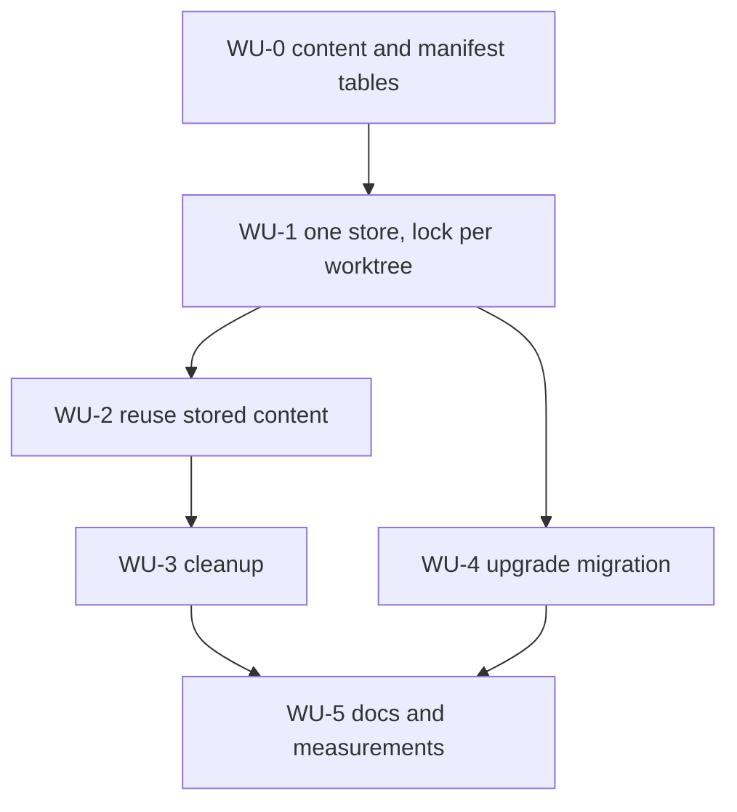

# ADR-0056 Execution Blueprint

- **Parent ADR:** [docs/adr/0056-share-one-code-index-across-worktrees.md](0056-share-one-code-index-across-worktrees.md)

## System Snapshot

Checked on `main` at `950aff30` (2026-10-27).

- Index schema and open: `crates/code/src/db.rs`. `SCHEMA_VERSION` is 2 (`:16`). `files` (`:58-68`), `symbols`, `imports` and `chunks` keyed by `file_id` (`:69-102`), contentless `chunks_fts` (`:103-108`). `open_index_with` deletes and recreates in `Index` mode (`:163-185`).
- Index run: `crates/code/src/index.rs`. `Options` with `batch_size: 200` and test `hooks` (`:25-45`), `Report` (`:84`), `Existing` (`:137`), `prepare` (`:241`, unchanged check `:270-281`), `clear_children` (`:318`), `mark_failed` (`:455-468`), `write_batch` (`:470`), `load_existing` (`:514`), `lock_path` and `acquire_lock` (`:546-579`), `run` (`:582`), `remove_unlisted` (`:719-745`).
- Queries: `crates/code/src/search.rs`, `ranked.rs`, `refs.rs`, `context.rs` (`term_weights` at `:323-334`), `status.rs` (`db_bytes` at `:189`, JSON at `:206-218`).
- Grammars: `crates/code/src/lang/mod.rs` (`Lang::for_path` `:38-49`, `Lang::name` `:53-60`).
- Paths: `crates/code/src/host.rs` (`index_db` `:36-48`, `worktree_id` `:51-53`), `crates/code/src/location.rs` (`index_path` `:55-57`), `crates/code/src/lib.rs` (`index` `:39`, `status` `:57`, `find_refs` `:131`, `build_context` `:152`), `crates/data/src/lib.rs` (`scoped_db_in` `:42`, `WORKTREE_KINDS` `:50`, `remove_worktree_dbs` `:54`, `orphan_dbs` `:77`).
- Command output: `crates/code/src/cli.rs` (index envelope `:680-692`).
- Worktree cleanup: `crates/cli/src/worktree/mod.rs` (`remove_data_of` `:287-296`).
- Migrations: `crates/cli/src/init/migrate.rs` (`registry` `:253`).
- Tests that fix today's layout: `crates/cli/tests/code_cli.rs` (`:161`, `:531`, `:566`), `crates/data/src/lib.rs` (`:141`, `:158`, `:185`), `crates/code/src/testkit.rs` (`:33-37`), `crates/cli/tests/worktree_sweep_keeps_new_work.rs` (`:217`, `:259`).
- Docs: `docs/internals/11-data-folder.md` (`:13`, `:26`, `:56`), `docs/adr/0026-local-code-index-in-the-binary.md` (`:3`, the Status line that now names ADR 0056).

Every Work Unit runs its tests with a private target dir, because parallel worktrees overwrite the shared `playbook` binary mid run.

## Measurements

Three checks, run in a scratch `HOME` so no real data folder is touched. The helper prints the median of 20 runs after one discarded warm-up run:

```bash
median() { python3 -I -c 'import statistics, subprocess, sys, time
t = []
for _ in range(21):
    s = time.perf_counter()
    subprocess.run(sys.argv[1:], stdout=subprocess.DEVNULL, check=True)
    t.append(time.perf_counter() - s)
print(round(statistics.median(t[1:]), 4))' "$@"; }
```

**M1. Duplicate content across worktrees (run before WU-0).** It shows whether sharing can save anything. It lists the committed files of every worktree at its `HEAD` and compares the total with the distinct blob ids. Committed content makes the result repeatable:

```bash
( set -eo pipefail
  out=$(mktemp)
  wts=$(git worktree list --porcelain | awk '/^worktree /{print $2}')
  for w in $wts; do
    git -C "$w" ls-tree -r HEAD | awk '{print $3}' >> "$out"
  done
  sort "$out" | uniq -c | awk '{t+=$1; d+=1} END {print "total", t, "distinct", d, "ratio", d/t}' )
```

A git error in any worktree stops the subshell before a ratio is printed. The worktree paths must not contain spaces.

Limit: the ratio is at most 0.5. A higher ratio means worktrees share too little for C to pay, and the work stops for a new decision (ADR 0056 alternative B). Result on 2026-10-28: total 57,473, distinct 2,530, ratio 0.044.

**M2. Speed on one worktree (WU-0 gate).** Baseline with the installed 0.39.0 binary (check that `playbook --version` prints 0.39.0, and record `git rev-parse --short HEAD` in the PR body so both sides use one commit): `OLD=$(mktemp -d) && HOME=$OLD playbook code index >/dev/null && HOME=$OLD median playbook code context "index lock" && HOME=$OLD median playbook code search --text "index lock" && HOME=$OLD median playbook code refs run_lock`. With the change: `cargo build --release && NEW=$(mktemp -d) && PB="$PWD/target/release/playbook" && HOME=$NEW "$PB" code index >/dev/null && HOME=$NEW median "$PB" code context "index lock" && HOME=$NEW median "$PB" code search --text "index lock" && HOME=$NEW median "$PB" code refs run_lock`. Limit: each median is at most 1.10 times its baseline. Each `median` call is the median of 20 timed runs after one warm-up run, and that value is the one the gate uses. A single run never decides the gate. The gate fails when the new value exceeds its limit. The PR body records both values and the load average at the start. When the load average is above the core count, run the check again and record the rerun.

**M3. Speed and disk on a store with many diverging worktrees (WU-2 gate).** Fifty-two detached worktrees at `HEAD~1` to `HEAD~50`, `HEAD~100` and `HEAD~200`. The store then holds 52 manifests. The 57 real worktrees carry a similar load, and the 5 missing manifests do not change the verdict, because the limits are ratios to the 0.39.0 baseline measured on the same 52 worktrees:

```bash
for n in $(seq 1 50) 100 200; do git worktree add --detach "/private/tmp/pb-0056-wt$n" "HEAD~$n" >/dev/null; done
```

Run every command in this block in bash or zsh (`HOME=$OLD median ...` gives a shell function a temporary environment). Check first that `$OLD/.config/playbook/data/code` and `$NEW/.config/playbook/data/code` exist after the first index, or the `du` figures measure nothing. Set `OLD_BIN` to the installed 0.39.0 binary and `NEW_BIN` to `$PWD/target/release/playbook`, and create two empty homes, `OLD=$(mktemp -d)` and `NEW=$(mktemp -d)`. Index each worktree with `HOME=$OLD "$OLD_BIN"` and with `HOME=$NEW "$NEW_BIN"`. Preconditions: `sqlite3` reports at least 52 rows in `worktrees` of the new store, and the baseline sum is `du -ck "$OLD"/.config/playbook/data/code/*/*/*.db* | tail -1` (each database with its `-wal` and `-shm`) (`(cd "/private/tmp/pb-0056-wt$n" && HOME=$OLD "$OLD_BIN" code index >/dev/null)` and the same with `$NEW` and `$NEW_BIN`). Then measure `code context`, `code search --text`, `code refs` and `code symbol run_lock` inside `/private/tmp/pb-0056-wt10` on both sides. Limits: each median is at most 1.10 times its baseline, and the new size, `du -ck "$NEW"/.config/playbook/data/code/*/*/store-v*.sqlite3* | tail -1` (the store with its `-wal` and `-shm`), is at most 0.5 times the sum of the 52 separate 0.39.0 index sizes. Each `median` call is the median of 20 timed runs after one warm-up run, and that value is the one the gate uses. A single run never decides the gate. The gate fails when the new value exceeds its limit. The PR body records both values and the load average at the start. When the load average is above the core count, run the check again and record the rerun. Cleanup: `for n in $(seq 1 50) 100 200; do git worktree remove --force "/private/tmp/pb-0056-wt$n"; done`.

A failed limit stops the work. A slow join is fixed first. A store that is too large goes back to ADR 0056, where alternative B is the fallback.

## Work Units

### WU-0: Split `files` into content and a manifest inside today's file

WU-0 ships as two pull requests, in this order. Part A holds the parser key and its tests (`hash_pins`, `parser_key` and the `EXTRACTOR_HISTORY` digest). Part B holds the schema, the view and the readers. Each part has its own Done When.

- Requires: nothing
- Goal: the per-worktree db holds `worktrees`, `content` and `manifest` tables in place of `files`, the child tables key on `content`, connections read scoped TEMP VIEWs named `files`, `symbols`, `imports` and `chunks` that keep today's columns (`file_id` is the content id), and every command returns the same results as before. The query modules keep their SQL. The sharing check M1 has passed.
- Files:
  - `crates/code/src/db.rs` | modify | new schema from ADR 0056 decision 2 (`STRICT` tables, `content.id`, `worktrees.id` and `chunks.id` are `AUTOINCREMENT` (`chunks.id` already is, `db.rs:96-97`), the indexes `manifest_content`, `symbols_content`, `imports_content` and `chunks_content`, `created_at` on `worktrees`), `SCHEMA_VERSION` 3, `meta` keeps only store-level keys, `write_tx(conn, &TxHooks)`, with `TxHooks` (`on_write_tx`, `fail_begin`, `fail_commit`, all `Option` callbacks, `Default` is none) defined in `db.rs`, the one helper that begins write transactions in `IMMEDIATE` mode, and `create_scope_views(conn, worktree_row_id: i64, kind)`, which creates `TEMP VIEW files` on every connection and the three child views on `Query` connections only, after the worktree's row is final. The create path sets `auto_vacuum = INCREMENTAL` before `journal_mode = WAL`, reads it back after the schema exists and runs `VACUUM` on the empty store if it is not 2. `Query` mode reads a zero-length file or a store with `user_version` 0 as `Missing` and writes nothing
  - `crates/code/src/lang/mod.rs` | modify | `Lang::grammar_id` (the private `grammar` at `:63` stays), a grammar id that keeps `tsx` apart from `typescript`, `TEXT_GRAMMAR` for files with no grammar, and `EXTRACTOR_REVISION`, with `parser_key()` joining `host::tool_version`, the revision (in a debug build, a hash of the extractor sources read with `include_str!`) and `hash_pins(text)` of the `tree-sitter*` lines of `crates/code/Cargo.toml`, read with `include_str!`
  - `crates/code/src/index.rs` | modify | `Options` (`:25-45`) gains `parser: String` (default `lang::parser_key()`). `prepare`, `write_batch`, `mark_failed`, `load_existing`, `clear_children`, `remove_unlisted` and `run` write `content` and `manifest`, and the run's meta values move to the `worktrees` row. The run creates the worktree's row at its start. The run fires `before_write` and the test marker right after the store opens, before its first write (the `worktrees` row insert), then again before each batch. When a manifest row is repointed, the same transaction deletes the old content row if no manifest references it (FTS rows first), because the existing edit and delete tests (`:782-869`) need it. WU-1 then changes where the file lives, how it is locked, and the rebuild, retry and corruption-hint rules. The unchanged check also compares the content's parser with the run's parser. `Hooks` (`:59-63`, test only) gains `before_read`, which `prepare` calls before `std::fs::read`, `before_write`, which the run calls after open and before each write transaction begins. Test code at `index.rs:1060` and `:1069` that reads `meta` reads the `worktrees` row. The test helpers `fts_paths` and `paths` (`:755-779`) query the manifest.
  - `crates/code/src/search.rs` (the query at `:225-260` and `literal_scan` at `:352-381` included), `refs.rs` | no SQL change | it reads the scoped views by the same names as today.
  - `crates/code/src/context.rs` | modify | `term_weights` (`:323-334`) counts through `symbols s JOIN files f ON f.id = s.file_id`. Two paths with the same bytes count twice, as today. Its other queries are unchanged.
  - `crates/code/src/ranked.rs` | modify | `ORDER BY f.path, i.line, i.rowid` (`:147`) needs the `imports` view to expose a `rowid` column. The view lists it.
  - `crates/code/src/status.rs` | modify | `status(conn, index_path, root, worktree)` takes the worktree key (`lib.rs` passes it). `last_run_started` and `last_run_completed` (and `interrupted`) come from the worktree's `worktrees` row, not `meta` (`:152`).
  - View bodies name `main.symbols`, `main.imports` and `main.chunks`. An unqualified name inside a temp view resolves to the view itself and is circular.
  - `crates/code/src/testkit.rs` | modify | `Fx` gains a worktree key. Every `db.rs` test call of `open_index` and `open_index_with` (`:307` to `:455`) passes it too. WU-0 adds the worktree parameter to `open_index` and `index::run`. The crate compiles and its tests pass at the end of WU-0. WU-1 moves the file, adds the locks and adds the rebuild, retry and corruption-hint rules.
  - `crates/code/src/lib.rs` | modify | `status`, `search`, `find_refs` and `build_context` (`:60, :94, :134, :155`) pass the worktree key to `open_index`, which creates the views, and `index` passes it to `index::run`
  - tests in the same files | modify and add
- Verification:
  - `CARGO_TARGET_DIR=/private/tmp/pb-target-0056 cargo nextest run -p playbook-code --config-file .github/nextest.toml`
  - `CARGO_TARGET_DIR=/private/tmp/pb-target-0056 cargo nextest run -p playbook --test code_cli --config-file .github/nextest.toml`
  - `CARGO_TARGET_DIR=/private/tmp/pb-target-0056 cargo clippy --workspace --all-targets -- -D warnings`
- Tests (TDD, unit tests in `crates/code/src`):
  - Given two paths with the same bytes, when `index::run` finishes, then `content` has one row, `manifest` has two, and `symbol` returns both paths.
  - Given an indexed `a.rs` and a `before_read` hook that returns an error for `a.rs`, when `index::run` runs again, then its manifest row is `failed`, keeps its `content` id, and `symbol` still finds its declarations. The test `an_unreadable_file_keeps_its_old_rows_and_counts_as_failed` (`index.rs:873-901`) is rewritten on the hook. It uses `chmod 000` today and skips its assertions when run as root (`:891`).
  - Given a file with a syntax error, when indexed, then its `content.partial` is 1 and its manifest status is `partial`.
  - Given a repo with no indexable file, when `index::run` finishes, then the report shows `indexed` 0 and `content` has no row.
  - Given `a.ts` and `a.tsx` with the same bytes, when indexed, then two `content` rows exist with grammars `typescript` and `tsx`, and both manifest rows show `lang` `typescript`.
  - Given a file written with `SCHEMA_VERSION` 2, when opened in `Index` mode, then it is rebuilt at 3, and in `Query` mode it reports `NeedsRebuild` and is not deleted.
  - Given the content row with the highest id deleted and a new content row inserted, then the new id is higher than the deleted one (`db.rs` unit test).
  - Given the chunk with the highest id deleted (and its `chunks_fts` row) and a new chunk inserted, then the new id is higher and its `chunks_fts` rowid equals it (`db.rs` unit test).
  - Given one fixture source per language (Rust, Python, JavaScript, TypeScript, TSX and Go), when the extractor runs, then the sha256 of its serialized symbols, imports, chunks and FTS body equals the digest in the last row of an append-only table `EXTRACTOR_HISTORY: &[(u32, &str)]` kept in the test, and the revision of that last row equals `EXTRACTOR_REVISION`. A change of extractor output makes the digest differ from the last row, and the failure message says to append a row with a higher revision and bump the constant. The old rows stay. A failure message tells the developer to append, and review checks the table is append-only.
  - (Part B) Given a manifest row whose content has another parser than the run, when the run checks the file, then it counts as changed.
  - Given two `Cargo.toml` texts that differ in one `tree-sitter-rust` version, then `hash_pins` returns two values, and the same text returns one value. In a debug build the revision part of `parser_key()` is a hash of the extractor sources, and a changed source text gives a different hash.
  - Table-driven, one row per pragma, given a fresh store, then `PRAGMA foreign_keys` reads 1, `PRAGMA auto_vacuum` reads 2 (incremental), `PRAGMA journal_size_limit` reads `WAL_SIZE_LIMIT`, `sqlite_version()` is 3.43 or later (`contentless_delete` needs it) (asserted as a precondition), `PRAGMA table_list` shows `strict` 1 for `worktrees`, `content`, `manifest`, `symbols`, `imports` and `chunks`, and inserting text into an integer column fails.
  - Table-driven, one row per query, given a store with several worktrees, then `EXPLAIN QUERY PLAN` for the repoint check (`SELECT 1 FROM manifest WHERE content = ?`) and for each hot query (`symbol`, ranked `search`, text `search`, `refs` and `context`) shows an index search and no full scan of `manifest`, `symbols` or `chunks`. For `term_weights`, whose `LIKE '%word%'` cannot use an index, the plan must show a `SEARCH` on `manifest_content` or `symbols_content` that restricts the scan to the worktree's content, and no scan of the whole `symbols` table.
  - Given a skipped path and a failed new path (no content), then both appear in the `files` view with a NULL `content`, and `status` counts them.
  - Given `--rebuild` in a worktree, then the run's final indexed count read through the view is not 0 (the view is created after the row is final).
  - Given the production part (the text before `#[cfg(test)]`) of `lib.rs`, `search.rs`, `ranked.rs`, `refs.rs`, `context.rs` and `status.rs` (`include_str!`), then none contains the word `manifest` (a backstop; the views are the mechanism).
  - Unit, `context.rs`: Given two paths with identical bytes in one worktree, each declaring `widget`, when `term_weights` runs for `widget`, then the document frequency it uses is 2 (one per path), not 1.
  - Given a `Query` connection, then `files`, `symbols`, `imports` and `chunks` resolve to TEMP views, and `term_weights` over `symbols` counts only the worktree's symbols (a sibling's symbols are excluded). Given an `Index` connection, then `symbols`, `imports` and `chunks` are the real tables.
  - Given two paths with the same bytes in one worktree, then a symbol query returns the declaration once per path, as today, and `files.id` is the same for both paths.
  - Given a file with no grammar (`lang` is NULL, as `refs.rs` allows), when it is indexed, then its `content.grammar` is `TEXT_GRAMMAR` (`text`) and it still gets chunks and FTS rows.
  - Given a store file with a valid SQLite header and `user_version` 0, when a `Query` open runs, then it returns `Missing` and the file bytes are unchanged.
  - Given a zero-length store file, when a `Query` open runs and then an `Index` open creates the store, then the query returned `Missing`, wrote nothing, and `PRAGMA auto_vacuum` reads 2 after creation.
  - Given a helper `db::write_tx(conn: &mut Connection, tx: &TxHooks)` that begins every write transaction (batch, repoint delete, cleanup chunk, `--rebuild` row, `forget_worktree`) in `IMMEDIATE` mode, then the production part (before `#[cfg(test)]`) of every module except `db.rs` (`include_str!` of `index.rs`, `lib.rs` and the query modules) contains none of `.transaction(`, `unchecked_transaction` and `transaction_with_behavior`. This text check is a backstop. The behavior of the helper is the test below.
  - Given a transaction from `write_tx` in which the test reads a row, then writes through a second connection with a busy timeout of 0, then that second write gets `SQLITE_BUSY` and the first transaction commits. With a deferred transaction the second write would commit and the first would fail with `SQLITE_BUSY_SNAPSHOT`. This test fails if the mode regresses. Every write path goes through the helper. WU-0 uses it for the batch and the repoint delete, and WU-3 uses it for the cleanup chunk and `forget_worktree`. The source check forbids any other way to begin a transaction.
  - Given a content row still referenced by a manifest row, when a second connection deletes it, then the delete fails with a foreign key error.
  - Given an edited file whose old content no manifest references, then that content row, its chunks and its FTS rows are gone after the run.
  - Every existing test in `playbook-code` and in `code_cli.rs` passes with its expected values unchanged. The tests that read `files` directly (`index.rs:896, 1116, 1216, 1230, 1282, 1330, 1373` and `db.rs:399, 428, 441`) are rewritten to query the manifest.
- Done When:
  - [ ] Part A: the parser key and its tests merge first, and change no behavior.
  - [ ] Part B: the schema in `db.rs` has no `files` table and no `file_id` column.
  - [ ] All three verification commands pass.
  - [ ] M1 passed before the first commit, and its output is in the PR body.
  - [ ] M2 passes against a build of this PR. The join cost is then known before the store exists.
  - [ ] The PR body records the changed line count. Over 500 lines needs a sentence of justification. Part B changes the writer side and the views. The query modules keep their SQL. The diff stays small. If it would still pass 1,500 lines, the PR body says so and the split is the writer side first (tables written next to the old `files` table), then the views and the drop of `files`.

### WU-1: One store file per repo, one run lock per worktree

- Requires: WU-0
- Goal: every worktree of a repo indexes into `<data>/code/<owner>/<repo>/store-v4.sqlite3`, each under its own `<worktree-id>.lock`, and each sees only its own paths. A worktree with no row in the store reads as having no index.
- Files:
  - `crates/data/src/lib.rs` | modify | `code_store_in(data, owner, repo, version)` and `code_store(version)`, which resolve the store path the way `scoped_db_in` and `scoped_db` resolve a worktree db
  - `crates/code/src/host.rs` | modify | `index_db` returns the store path and stops the `Policy::Cache` move of the old file. The choice between the store path and the state folder path (`:36-40`) moves into a pure `choose_index_path(scoped, old)`.
  - `crates/code/src/location.rs` | modify | `index_path` doc comment
  - `crates/code/src/db.rs` | modify | `SCHEMA_VERSION` 4, `store_file_name(version)`, a `worktrees` row lookup or insert by key, and `Query` mode returns `DbError::Missing` when the file has no row for the worktree
  - `crates/code/src/index.rs` | modify | `lock_path(store, worktree)` returns `<worktree>.lock` beside the store. `fallback_lock_path(index)` returns `index.lock` beside a store at the state-folder fallback path (`host::index_db` returns it when `choose_index_path` picks the fallback), and the run uses it in place of `lock_path` there. Every statement is scoped to the worktree's row. Batches use `db::write_tx` (WU-0). `--rebuild` is described in the row below.
  - `crates/code/src/db.rs` | modify | `StoreLock` on `store-v<N>.lock` beside the store: one handle, a shared lock (`try_lock_shared`) held by every run and query (and by the hook refresh S33 adds), released explicitly on drop. Recovery order on the same handle: release shared, `try_lock` exclusive, open the store again and check it, delete and recreate only if it is still damaged, create the schema, then release the exclusive lock and retake the shared lock (the exclusive lock is not held to the end of the run). When the exclusive lock is not available, the open fails with "another worktree is using the index; try again", the store path and the remedy, and nothing is deleted. `Query` opens poll the shared lock `LOCK_POLL_TRIES` (5) times, `LOCK_POLL_MS` (10 ms) apart, then fail with "the index is being rebuilt; try again". Files are deleted in the order `-wal`, `-shm`, main. `db.rs` reads `PLAYBOOK_CODE_BUSY_TIMEOUT_MS` to override `BUSY_TIMEOUT` only when `cfg!(debug_assertions)` is true. The integration tests run the debug binary. No Cargo feature is added. `open_index` takes a db-level hooks struct, `DbHooks` (its deleter is the same injected deleter as `Hooks::delete_file`), with `before_schema` (called in creation before `BEGIN IMMEDIATE`), `after_open` (called after the shared lock is taken and the schema is checked), `after_recovery` (called after the exclusive lock is released and before the shared lock is taken) and `on_poll` (called once per poll attempt), both no-ops outside tests. The delete step takes an injected deleter. A test can make it fail as it does on Windows. Open modes: `Index`, `Query` and `Maintenance` (never creates or deletes, `foreign_keys` on, busy timeout `FORGET_BUSY_MS`).
  - `crates/code/src/index.rs` | modify | `Hooks` gains a `tx: TxHooks` field and `fail_write(code)`. `--rebuild` first runs `PRAGMA quick_check(1)` and the FTS5 `integrity-check` on `chunks_fts`. On a healthy store it deletes this worktree's `worktrees` row, ignores the hint set, parses every file and replaces the children per content key. It first opens the store and runs `PRAGMA quick_check(1)`. When that fails it recovers the whole store (other worktrees read as `Missing` until they index) and indexes this worktree. A damaged store that a sibling holds exits 1 with the store path and the remedy. The report sets `scope` to `"store"` or `"worktree"`. A batch retries from `BEGIN IMMEDIATE` through `COMMIT` as one unit (the `Report` counters of the batch, `reused` included, are staged per attempt and added after `COMMIT`), `BATCH_RETRIES` (3) times on `SQLITE_BUSY`. `TxHooks::fail_begin` and `TxHooks::fail_commit` inject the error at `BEGIN` and at `COMMIT` in tests. In debug builds (`cfg!(debug_assertions)`) the `code index` command in `cli.rs` installs a `before_write` hook when `PLAYBOOK_CODE_TEST_MARKER` is set. On its first call the hook prints `marker: ready` to stdout and flushes. `Hooks::fail_write(code)` makes the first insert of a batch return that error code after `BEGIN`. The transaction hooks are the `db.rs` `TxHooks` from WU-0 (`on_write_tx` is called by `db::write_tx` each time it begins a transaction). `index::Hooks` holds a `TxHooks`, and `forget_worktree` and non-test callers pass `TxHooks::default()`. A query or run-write error with primary code `SQLITE_CORRUPT` or `SQLITE_NOTADB` (so `CORRUPT_VTAB` too) maps to `NeedsRebuild` with the `--rebuild` hint (mapping in `db.rs`).
  - `crates/code/src/cli.rs` | modify | the envelope path is the store path
  - `crates/code/src/cli.rs` | modify | (also) render `scope` in the JSON and the text output as ADR decision 7 states, and install the marker hook. `Report.scope` is added here.
  - `crates/code/src/search.rs`, `ranked.rs`, `refs.rs`, `context.rs`, `status.rs` | modify | each turns a rusqlite error into a `String` today (`search.rs:257`, `ranked.rs:15-17`, `refs.rs:93`, `context.rs:118-120`, `status.rs:162-164`). Each routes it through `db::map_sql_error`, which returns the `NeedsRebuild` text with the `--rebuild` hint for `SQLITE_CORRUPT` and `SQLITE_NOTADB` and the old text otherwise. One unit test per module damages the page its own query reads (a `manifest` page for `status.rs`, a `symbols` page for `ranked.rs` and `context.rs`, the `chunks_fts` page for `search.rs` and for `refs.rs`, whose error surfaces at `rows.collect` at `:97-99`) and asserts the hint.
  - `crates/cli/tests/code_cli.rs` | modify | `:161` asserts the store file name. `:531` and `:566` become: an old per-worktree index file is ignored and a fresh store is built.
- Verification:
  - `CARGO_TARGET_DIR=/private/tmp/pb-target-0056 cargo nextest run -p playbook-code -p playbook-data --config-file .github/nextest.toml`
  - `CARGO_TARGET_DIR=/private/tmp/pb-target-0056 cargo nextest run -p playbook --test code_cli --config-file .github/nextest.toml`
  - `CARGO_TARGET_DIR=/private/tmp/pb-target-0056 cargo clippy --workspace --all-targets -- -D warnings`
- Tests (Gherkin; each test builds its own fixture repo, worktrees and scratch `HOME`. No test depends on another. Integration tests are in `crates/cli/tests/code_cli.rs` with a second worktree from `git worktree add`):
  - Scenario: two worktrees share one store
    - Given worktree a with `only_a.rs` and worktree b without it
    - When `playbook code index --json` runs in a, then in b
    - Then both envelopes name the same `store-v4.sqlite3` path and no `<worktree-id>.db` file exists
    - And `playbook code symbol only_a --json` in b returns no result
  - Scenario: a new worktree of an indexed repo has no index yet
    - Given worktree a indexed and worktree b never indexed
    - When one command runs in b, as one test per command: `status --json`, `symbol`, `search --text` and `context`
    - Then `status` reports the index as missing and exits 0, and each other command exits 1 and says to index first
    - And the store has no row for b
  - Scenario: the run lock is per worktree (integration)
    - Given the test holds an exclusive lock on a's `<worktree-id>.lock` file
    - When `playbook code index` runs in a
    - Then it exits 1 and says "another index run is in progress"
    - When `playbook code index` runs in b
    - Then it exits 0
  - Scenario: two runs in two worktrees at the same time (integration)
    - Given worktrees a and b of a fixture repo made for this test, the store created by a first `code index` in a, and the test process holding a write transaction on it
    - When `playbook code index` runs in both, and each child runs with `PLAYBOOK_CODE_BUSY_TIMEOUT_MS` set to 30,000 (an env var read only in debug builds, above `START_TIMEOUT_MS`) and prints a marker (`PLAYBOOK_CODE_TEST_MARKER`, debug builds only) after it opened the store and before its first batch. `Fixture::playbook` clears the environment (`code_cli.rs:80-89`). The test passes both variables through a named helper that uses `Command::spawn()` with piped stdout and reads the markers with a bounded wait (`Fixture::playbook` uses `.output()`, which blocks until the child exits and would deadlock on the held transaction)
    - Then the parent waits for both markers (bounded by `START_TIMEOUT_MS`, 10,000 ms), and both children are still running (`try_wait()` returns `None`) at that point, because neither can write while the test holds the transaction. The check is a final assertion, not a sleep: the markers order the steps
    - When the test commits its transaction
    - Then both exit 0, and the store has two `worktrees` rows
    - And `PRAGMA integrity_check` returns `ok` and `PRAGMA foreign_key_check` returns no row
  - Scenario: a writer waits for a held write transaction (unit test in `index.rs`)
    - Given a second connection that holds a `BEGIN IMMEDIATE` transaction on the store, and a `Hooks::before_write` hook that sends on a channel just before the run begins a batch
    - When worktree b runs on its own thread, and the holder commits only after it receives that message, then sends `committed` on a second channel after COMMIT returns
    - Then the test reads the run's result only after it receives `committed`. The run succeeds and reports no failure, and a `TxHooks::on_write_tx` callback, which fires after the run's `BEGIN IMMEDIATE` succeeded, finds the marker row that the holder inserted and committed (so the batch began after the holder's COMMIT). The run's busy timeout is `BUSY_TIMEOUT`
    - And no timing constant is involved: the channel orders the two sides
  - Scenario: rebuild of a healthy store touches only this worktree
    - Given a and b indexed and the store healthy
    - When `playbook code index --rebuild` runs in a
    - Then a is reindexed, the JSON has `scope: "worktree"` and the text has `rebuilt: worktree only`, and `playbook code symbol` in b returns the same JSON as before
  - Scenario: a build opens only its own store version (unit test in `db.rs`)
    - Given `store-v3.sqlite3` holding a marker row, `store-v3.lock` held shared by the test, and a corrupt `store-v4.sqlite3` in one folder
    - When `open_index` runs on the v4 path in `Query` mode
    - Then it returns `NeedsRebuild` and the v4 file still exists
    - When `open_index` then runs on the v4 path in `Index` mode
    - Then the v4 file is a valid empty store, `store-v3.sqlite3` is byte for byte unchanged, and the held v3 lock does not block the v4 recovery
  - Scenario: the old file stays (unit test in `host.rs`)
    - Given an old `<worktree-id>.db` file and a scoped path
    - When `index_db` runs
    - Then it returns the store path and the old file still exists
    - And `fallback_lock_path` of the fallback path is `<state folder>/code/index.lock`
  - Scenario: a run at the fallback path takes `index.lock` (unit test in `index.rs`)
    - Given the test holds an exclusive lock on `<state folder>/code/index.lock` and a store at the fallback path
    - When `index::run` runs on that path
    - Then it fails with "another index run is in progress"
  - Scenario: the fallback path (unit test in `host.rs`)
    - Given `choose_index_path` with no scoped path
    - Then it returns the state folder path
    - Given a scoped path, then it returns that path
  - Scenario: two cold-start runs create the store once (unit test in `db.rs`)
    - Given no store file, and a `before_schema` hook on the first `Index` open, called before it takes `BEGIN IMMEDIATE`, that runs a second `Index` open on the same path to completion
    - When the first open completes
    - Then both opens succeed, the first open finds the schema when it re-checks `user_version` under its lock and does not write it again, and nothing was deleted
  - Scenario: runs and queries hold the shared store lock (unit tests in `index.rs` and `db.rs`)
    - Given a `Hooks::before_write` hook that tries an exclusive `try_lock` on `store-v4.lock`
    - When a run reaches its first batch (S33 tests the hook refresh case when it builds `refresh_at`)
    - Then the exclusive `try_lock` fails
    - Given a db-level `after_open` hook, called in a `Query` open after the shared lock is taken, that tries an exclusive `try_lock` on `store-v4.lock`
    - When a `Query` open runs (the `search` path)
    - Then the exclusive `try_lock` fails
  - Scenario: a query waits briefly for an exclusive lock (unit test in `db.rs`)
    - Given a store file with the current schema, and the test holds the exclusive lock
    - When a `Query` open runs
    - Then it polls `LOCK_POLL_TRIES` times (the `on_poll` hook counts the calls), then returns "the index is being rebuilt; try again", and writes nothing
  - Scenario: recovery after corruption (unit tests in `db.rs`, no threads)
    - Given a store with a damaged header
    - When `open_index` runs in `Index` mode
    - Then the store is recreated, `PRAGMA auto_vacuum` reads 2, and the returned handle holds the shared lock, not the exclusive one (the test calls `try_lock` on `store-v4.lock` from a second handle and sees it fail)
    - When a second `open_index` runs
    - Then it finds a healthy store, deletes nothing, and the file is unchanged (on unix, the inode is the same, asserted under `cfg(unix)`; on every platform, the file bytes are the same)
    - Given an `after_recovery` hook, called after the exclusive lock is released and before the shared lock is taken, that runs a third `open_index`
    - Then the third open finds a healthy store and deletes nothing
  - Scenario: a damaged store with a sibling using it (unit test in `db.rs`)
    - Given a damaged `store-v4.sqlite3` and a shared `store-v4.lock` held by the test
    - When `open_index` runs in `Index` mode
    - Then it fails with "another worktree is using the index; try again", the store path and the remedy, the file still exists, and it is unchanged (the same `cfg(unix)` inode check, plus the same bytes on every platform)
    - When the test releases the lock and `open_index` runs again
    - Then the store is rebuilt
  - Scenario: delete order and a failed delete (unit tests in `db.rs`)
    - Given an injected deleter that records its calls
    - When recovery deletes a store
    - Then the order is the `-wal` file, the `-shm` file, then the main file
    - Given an injected deleter that fails on the main file, as an open file does on Windows
    - When recovery runs
    - Then the open returns `DbError::Failed` naming the file, and no retry happens within the run
  - Scenario: rebuild repairs a damaged store (integration test in `code_cli.rs`; `text_search` calls `fts_rows` first, `search.rs:293`, and reads `literal_scan` only after it)
    - Given a store that indexes one file with one chunk containing the word `needle` (the FTS index then has one leaf page), and the test reads the `rootpage` of `chunks_fts_data` (the FTS5 shadow table) from `sqlite_schema` and the page size, then overwrites only the bytes of that page with garbage
    - And `PRAGMA quick_check` on the store is not `ok`, and a raw connection running `SELECT count(*) FROM chunks_fts WHERE chunks_fts MATCH 'needle'` returns an error (both are preconditions the test asserts), and the store still opens
    - When `playbook code search --text needle` runs
    - Then it exits 1 and the message names `--rebuild`. The mapping matches the primary error code (`sqlite_error_code()` returns `DatabaseCorrupt` for `SQLITE_CORRUPT_VTAB` too)
    - When `playbook code index --rebuild` runs
    - Then the JSON has `scope: "store"` and the text has `rebuilt: store`, `search` works, and other worktrees read as missing until they index
  - Scenario: rebuild of a damaged store with a sibling using it (integration or unit test)
    - Given the same damaged store and a sibling that holds the shared store lock
    - When `playbook code index --rebuild` runs
    - Then it exits 1, names the store path and the remedy, and changes nothing
  - Scenario: corruption inside a run write (unit test in `index.rs`)
    - Given `Hooks::fail_write(SQLITE_CORRUPT)`
    - When the run executes
    - Then it exits with the `NeedsRebuild` message that names `--rebuild`
  - Scenario: a busy commit is retried (unit test in `index.rs`)
    - Given a `TxHooks::fail_begin` hook that returns `SQLITE_BUSY` at `BEGIN` for the first two attempts
    - When a run executes
    - Then it succeeds with no failure in the report, and `parsed` and `changed` equal the file count (the counters are staged per attempt and added after `COMMIT`; a retry does not count a batch twice)
    - Given the hook fails `BATCH_RETRIES` plus 1 attempts
    - Then the run fails with the busy error
    - Given a `TxHooks::fail_commit` hook that returns `SQLITE_BUSY` at `COMMIT` for the first two attempts
    - Then the run succeeds, and with `BATCH_RETRIES` plus 1 failures it fails with the busy error
  - Scenario: queries stay inside the worktree (unit tests in `search.rs` including `literal_scan`, `refs.rs`, `ranked.rs`, `context.rs` and `status.rs`)
    - Given worktree a with `only_a.rs` and worktree b without it, both in one store
    - When each of `refs`, `ranked` search, `context`, `status` and text search (`text_search`, which reaches `literal_scan`) runs for b, as one test per query, the text search using a term that appears only in `only_a.rs`
    - Then `only_a.rs` is in none of the results, `status` counts only b's files, and the `files_scanned` count of the literal scan equals b's file count
  - Scenario: queries create nothing when there is no store (integration test in `code_cli.rs`; a `Query` open on an existing store may create `store-v4.lock` to take its shared lock)
    - Given a worktree with no store
    - When `playbook code status` and `playbook code search --text word --json` run
    - Then `status` reports the index as missing and exits 0, `search` exits 1 and says to index first, and none of `store-v4.sqlite3`, its `-wal`, its `-shm` and `store-v4.lock` exists (a query with no store file returns `Missing` before it takes the lock)
  - Scenario: debug-only seams are off in a release build (integration test, `cargo test --release`)
    - Given `PLAYBOOK_CODE_TEST_MARKER` and `PLAYBOOK_CODE_BUSY_TIMEOUT_MS` set
    - When a release binary runs `code index`
    - Then no marker line is printed and the busy timeout stays at `BUSY_TIMEOUT`
  - Scenario: `db_bytes` is the shared store size (integration test in `code_cli.rs`)
    - Given worktrees a and b indexed
    - When `playbook code status --json` runs in each
    - Then both report `db_bytes` equal to the size of `store-v4.sqlite3`
  - Scenario: two clones share one store (integration test in `code_cli.rs`)
    - Given two clones of the fixture repo whose `origin` URLs name the same owner and repo
    - When `playbook code index --json` runs in each
    - Then both envelopes name the same store path, and the store has two `worktrees` rows
  - Scenario: an empty repo (integration test in `code_cli.rs`)
    - Given a repo with one commit and no source file
    - When `playbook code index --json` runs
    - Then it exits 0 with `indexed` 0, and the store has one `worktrees` row and no `content` row
  - Scenario: context weights come from the current worktree (unit test in `context.rs`)
    - Given a store where worktree a holds 50 files declaring `widget` and worktree b holds 2
    - When `term_weights` runs for b
    - Then the weights equal those of a store that holds worktree b alone
  - Scenario: search results with a sibling's content (unit test in `search.rs`)
    - Given worktree b holds 5 files that contain the query term and worktree a holds 50 more
    - When `search` runs in b with a single-term query and a limit of 10, with all chunks of equal length, and a's 50 files also contain the term
    - Then the set of its 5 paths equals that of a store that holds worktree b alone. The order is not pinned, because the ranking statistics are store-wide. Multi-term ordering can shift with store-wide statistics and is not pinned.
- Done When:
  - [ ] Two worktrees of the fixture repo produce one store file and two `worktrees` rows.
  - [ ] All three verification commands pass.
  - [ ] The PR body records the changed line count. A diff that would pass 1,500 lines splits into two PRs: the store path, the lock and the `worktrees` rows first, then the `Missing` rule and the remaining tests. WU-1, WU-2 and WU-3 release together: no release ships with WU-1 alone, because the store would grow without cleanup.

### WU-2: Reuse stored content in a new worktree

- Requires: WU-1
- Goal: a file whose `(sha256, grammar, parser)` key is in the store is not parsed again. A cleanup that deletes that content mid run causes a parse and never a wrong mapping. An edit leaves no unreferenced content behind.
- Files:
  - `crates/code/src/index.rs` | modify
    - The run reads the set of content keys once at its start. The set is a hint that decides which files to parse, and it carries no id.
    - An `Adopt` outcome writes the manifest row with `INSERT INTO manifest(...) SELECT ..., id, CASE WHEN partial THEN 'partial' ELSE 'ok' END FROM content WHERE sha256 = ? AND grammar = ? AND parser = ? ON CONFLICT(worktree, path) DO UPDATE SET content = excluded.content, ...` inside the batch transaction. When it inserts no row, the file goes to the parse queue of the next batch, which reads and hashes it again. When it replaced an existing manifest row, the same transaction deletes the old content row if no manifest references it (FTS rows first).
    - `--rebuild` ignores the hint, parses every file, and replaces the children of each content row it reaches in one transaction per row.
    - `Report` gains `reused`. The `parser` value comes from `lang::parser_key()` (WU-0), and `Options.parser` (added in WU-0) carries it so a test can set it.
    - `Hooks` gains `after_hint`, which runs after the hint is read and before the first batch.
  - `crates/code/src/cli.rs` | modify | `reused` in the JSON envelope and in the text summary
  - `crates/cli/tests/code_cli.rs` | modify | the envelope test at `:99` asserts `reused`
- Verification:
  - `CARGO_TARGET_DIR=/private/tmp/pb-target-0056 cargo nextest run -p playbook-code --config-file .github/nextest.toml`
  - `CARGO_TARGET_DIR=/private/tmp/pb-target-0056 cargo nextest run -p playbook --test code_cli --config-file .github/nextest.toml`
- Tests (TDD, unit tests in `index.rs` with `testkit::fx`):
  - Given the integration test `code_cli.rs` indexes a and then b with the same 3 files, when `playbook code index` runs in b, then the text output has the line `reused: 3` and the JSON has `reused` 3.
  - Given worktree a indexed with 3 files, when worktree b with the same 3 files runs, then b's report has `parsed` 0 and `reused` 3, and `content` still has 3 rows.
  - Given b differs from a in one file, when b runs, then `parsed` is 1 and `reused` is 2.
  - Given b already has a manifest row for `x.rs`, and `x.rs` is edited to bytes whose content a already holds, when b runs, then the row points at that content, `reused` counts it, and the old content row is gone if no manifest references it.
  - Given an adopt that inserts no row for a file in the last batch (an `after_hint` hook deleted a's manifest rows for that file through a second connection, then its content row, because `ON DELETE RESTRICT` blocks the content delete while a manifest row references it), when the run executes, then that file is parsed in a trailing batch and the run ends with every file listed in the manifest.
  - Given an `after_hint` hook that, through a second connection, deletes the manifest rows that reference the content of `x.rs` (so `ON DELETE RESTRICT` allows it), deletes that content row (the one with the highest id, where a plain rowid would be reused; the fixture indexes `x.rs` last so its content holds the highest id, and the test asserts that this id is the one deleted), and inserts a content row for a different file whose id must then be higher than the deleted one, when b runs, then the report has no failure, `x.rs` is `ok` in b's manifest, its symbols are the ones of `x.rs`, and no manifest row points at the other file's content by mistake.
  - Given worktree a indexed with `Options.parser` `0.39.0.1`, when worktree b is indexed with `Options.parser` `0.40.0.1` and `symbol` and `search` then run in a, then both return a's symbols (queries serve rows whatever the parser).
  - Given a store filled with parser `0.39.0.1`, when a run uses parser `0.40.0.1`, then `parsed` equals the file count, `reused` is 0, and `content` holds both versions until cleanup.
  - Given `x.rs` edited and refreshed in a, when b still references the old content, then that content row, its chunks and its FTS rows stay.
  - Given a file with a syntax error indexed in a, when b adopts it, then b's manifest status is `partial`.
  - Given a file with no grammar (for example `notes.txt`) indexed in a, when b indexes the same bytes, then `content.grammar` is `text` for the row, `parsed` is 0 and `reused` counts it.
  - Given a file with invalid UTF-8, when indexed in a and then adopted by b, then both manifest rows read `partial`.
  - Given the store holds the content of `a.ts`, when b indexes `a.tsx` with the same bytes, then `parsed` is 1, `reused` is 0, and the symbols come from the TSX grammar.
  - Given the symbols of one content row deleted by the test, when `--rebuild` runs in a, then `symbol` finds them again in a and in b.
- Done When:
  - [ ] The scenarios pass and the second `code index` in a fresh worktree of this repo reports `parsed` at 0 when no file differs.
  - [ ] The PR body records the first index time of a new worktree of this repo, before and after.
  - [ ] M3 passes against a build of this PR, and its output is in the PR body. A failed limit stops the work.

### WU-3: Clean up unused content, dead worktrees and old stores

- Requires: WU-2
- Goal: unreferenced content, dead worktree rows and old store files are removed by `code index` in short transactions. Removing a worktree deletes its `worktrees` row and its lock file at once.
- Files:
  - `crates/code/src/index.rs` | modify
    - Constants `CLEANUP_CHUNK` (50 content rows), `DEAD_ROOT_GRACE` (7 days) and `STALE_STORE_GRACE` (30 days).
    - `collect_garbage(conn, store, hooks: &Hooks, now_ms: i64)` runs at the end of `run`. It loops over transactions of at most `CLEANUP_CHUNK` rows each: dead `worktrees` rows first (one at a time, its manifest rows in chunks of at most `CLEANUP_CHUNK`, then the row), then content with no manifest reference (FTS rows first).
    - A row is dead when `Path::try_exists` on its root returns `Ok(false)` and the later of its `last_run_completed` and `created_at` is older than `DEAD_ROOT_GRACE`. An error keeps the row.
    - A failure in the loop (busy store, constraint error) stops it and sets `cleanup: skipped` in the report. The run still succeeds. `Hooks` gains `fail_cleanup`, which makes a chunk return a busy error in tests.
    - It selects the ids of a chunk once into a temporary table. The FTS delete and the content delete then act on the same rows. After the loop it runs `PRAGMA incremental_vacuum(VACUUM_PAGES)` (1,000 pages) and a passive WAL checkpoint.
    - A file delete that fails is skipped for that file and does not set `cleanup: skipped`.
    - It deletes the `<id>.lock` file of each dropped row, and the files (with `-wal` and `-shm`) of any `store-v<M>.sqlite3` with `M` below the current version that no process modified for `STALE_STORE_GRACE`.
    - `Hooks` gains `before_vacuum`, called once after the delete loop and before `incremental_vacuum`.
    - `Hooks` gains `delete_file`, an injected deleter for stale store and lock files.
    - `Hooks` gains `after_cleanup_chunk`, called with the number of rows the chunk deleted, and only for a non-empty chunk. The delete loop stops when a chunk selects fewer than `CLEANUP_CHUNK` rows. Then 0 rows give 0 calls, 50 give 1, 51 give 2 and 450 give 9. `Options` gains `now_ms` for tests.
  - `crates/code/src/cli.rs` | modify | `Report.cleanup` (`"done"` or `"skipped"`) is rendered in the JSON and as the text line `cleanup: skipped` when skipped.
  - `crates/code/src/lib.rs` | modify | `pub fn forget_worktree(data: &Path, slug: &str, worktree: &str) -> Result<(), String>`. It opens the store in `Maintenance` mode (never creates or deletes, `foreign_keys` on, shared store lock, busy timeout `FORGET_BUSY_MS`), checks the path segments as `remove_worktree_dbs` does (`crates/data/src/lib.rs:58`), deletes the row and `<worktree>.lock` (the lock even when no store exists), and creates no store file. A busy store or a lock failure returns `Ok`: the dead-root rule removes the row later.
  - `crates/cli/src/worktree/mod.rs` | modify | `remove_data_of` calls `playbook_code::forget_worktree` after `remove_worktree_dbs`
  - `crates/cli/tests/worktree_sweep_keeps_new_work.rs` | modify | `:217` and `:259` also cover the store row and the lock file
- Verification:
  - `CARGO_TARGET_DIR=/private/tmp/pb-target-0056 cargo nextest run -p playbook-code --config-file .github/nextest.toml`
  - `CARGO_TARGET_DIR=/private/tmp/pb-target-0056 cargo nextest run -p playbook --test worktree_sweep_keeps_new_work --config-file .github/nextest.toml`
- Tests:
  - Unit, `index.rs`: Given a and b share `shared.rs` and only a has `only_a.rs`, when `forget_worktree` drops a and b runs `code index`, then the content of `shared.rs` stays and the content of `only_a.rs` and its symbols, chunks and FTS rows are gone.
  - Unit, `index.rs`: Given a dead worktree with 120 manifest rows, when cleanup runs, then its rows go in transactions of at most `CLEANUP_CHUNK` rows (the `after_cleanup_chunk` counts sum to 120 plus the content it frees) and the `worktrees` row goes last.
  - Unit, `index.rs`: Given a store with nothing to clean and a `TxHooks::on_write_tx` counter, when `collect_garbage` is called directly, then the counter reads 0 during cleanup, the report has no `cleanup: skipped`, and a second connection that holds an open write transaction (opened before `collect_garbage` runs) is still open afterwards. No wall-clock value is asserted.
  - Unit, `index.rs`: Given `store-v3` files 31 days old and a `store-v3.lock` file, when cleanup deletes the store, then the lock file is deleted too.
  - Unit, `lib.rs`: Given a `<id>.lock` file and no store file, when `forget_worktree` runs, then the lock file is gone and no store file is created.
  - Unit, `index.rs`: Given a and b share `shared.rs`, when a removes it from its tree and runs `code index`, then `symbol` in b still returns its declaration and the content row still exists (`remove_unlisted` deletes the manifest row only).
  - Unit, `index.rs`: Given b's manifest row for `x.rs` is `failed` and keeps its content id, when cleanup runs, then that content stays.
  - Unit, `index.rs`: Given a `worktrees` row whose root is gone and whose `last_run_completed` is older than `DEAD_ROOT_GRACE`, when b runs `code index`, then that row, its manifest and its lock file are gone.
  - Unit, `index.rs`: Given the same row with a `last_run_completed` of `DEAD_ROOT_GRACE` minus 1 second before `now`, then the row stays. At plus 1 second it is dropped.
  - Unit, `index.rs`: Given a dead-root row with a NULL `last_run_completed` and a `created_at` older than the grace, then it is dropped. With a `created_at` inside the grace, it stays.
  - Unit, `index.rs`: Given the `fail_cleanup` hook, when b runs `code index`, then the run exits 0, the report shows `cleanup: skipped`, and the unreferenced content is still there.
  - Unit, `index.rs`: Given a `worktrees` row whose root exists and whose timestamps are far older than the grace, then the row stays.
  - Unit, `index.rs`, `cfg(unix)` (Windows maps the missing component to `Ok(false)`): Given a root path under a regular file (`file.txt/child`), for which `try_exists` returns an error, and an old `last_run_completed`, then the row stays.
  - Unit, `index.rs`: Given 450 unreferenced content rows, when cleanup runs, then all are gone, the `after_cleanup_chunk` hook was called `ceil(450 / CLEANUP_CHUNK)` times, the counts it received sum to 450, and each is at most `CLEANUP_CHUNK`. The same test runs with 0 rows (no call), `CLEANUP_CHUNK` rows (1 call) and `CLEANUP_CHUNK + 1` rows (2 calls).
  - Unit, `index.rs`: Given `store-v3.sqlite3` with a `-wal` and a `-shm` file that the test writes as plain files (SQLite removes them when the last connection closes), each asserted to exist first and last modified `STALE_STORE_GRACE` plus 1 second ago, when cleanup runs next to a current `store-v4.sqlite3`, then all three v3 files are gone.
  - Unit, `index.rs`: Given the same v3 files last modified `STALE_STORE_GRACE` minus 1 second ago, then they stay.
  - Unit, `index.rs`: Given the v3 files 31 days old and `store-v3.lock` held shared by the test, when cleanup runs, then all v3 files stay. When the test releases the lock, the next cleanup deletes them. Cleanup takes an exclusive `try_lock` on the old version's lock file before it deletes.
  - Unit, `index.rs`: Given a v3 main file 31 days old whose `-wal` was modified 1 day ago, then all v3 files stay.
  - Unit, `index.rs`: Given `store-v5.sqlite3` 31 days old next to a v4 run, then it stays. Given `store-v10.sqlite3` 31 days old, then it also stays, because versions compare as numbers. Given `store-v2` and `store-v3` 31 days old, both are gone. Given `store-v9` 31 days old, it stays on a v4 run: only versions below the current one are deleted.
  - Every mtime in these cases is `now_ms` minus the case's offset, set with `File::set_modified`. The test passes `now` through `Options` (a `now_ms` field that defaults to the system clock). Every timestamp the run writes (`last_run_started`, `last_run_completed`, `created_at`) and every age check reads `now_ms`. No case reads the wall clock. "Older than" is strict: a row exactly `DEAD_ROOT_GRACE` old stays.
  - The dead-root and stale-store cases above run as two parameterised table tests, one row per case, and the table includes a row with an old `created_at` and a recent `last_run_completed` (kept: the later of the two counts).
  - Integration, `worktree_sweep_keeps_new_work.rs:217`: Given a merged worktree with an indexed store row, when `playbook worktree sweep` removes it, then its `worktrees` row and its `<id>.lock` are gone and the sibling's row stays.
  - Integration, `:259`: Given a removed worktree whose id a live worktree shares, then the row and the lock stay.
  - Unit, `lib.rs`: Given `forget_worktree`, then the manifest rows of the worktree are gone through the cascade (so `foreign_keys` was on), a missing store is not created, an unsafe segment (`..`, a `/` or `\\` in a segment, an absolute path and a symlinked owner or repo folder) changes nothing, and a store held busy beyond `FORGET_BUSY_MS` returns `Ok` with the row still there.
  - Unit, `index.rs`: Given 450 unreferenced rows deleted by cleanup, then `Hooks::before_vacuum` (called after the delete loop and before `incremental_vacuum`) reads a `freelist_count` above 0, and after the run it reads a lower count, and the file size has not grown.
  - Unit, `index.rs`: Given `Hooks::delete_file` (an injected deleter that `collect_garbage` calls for each stale store file and lock file, defaulting to `std::fs::remove_file`) that fails for one stale file, then the other stale files are still deleted and the report does not show `cleanup: skipped`.
- Done When:
  - [ ] Both verification commands pass.
  - [ ] `collect_garbage` has one caller outside tests, in `run` (`rg -n collect_garbage crates` lists its definition, that call and tests only).
  - [ ] The PR body records the longest cleanup transaction and the longest 200-file index batch on this repo. Measure each transaction with a debug-build `TxHooks` timer that starts in `on_write_tx` (after `BEGIN IMMEDIATE` succeeded) and stops when `COMMIT` returns, on the M3 store of 52 worktrees, and record the maximum of the chunk times. A cleanup transaction over 100 ms stops the PR until `CLEANUP_CHUNK` is lowered. Run the measurement three times, record the load average at the start, and use the median of the three maxima. When the load average is above the core count, run it again and record the rerun. The row count per chunk (at most `CLEANUP_CHUNK`) is the deterministic bound that the unit test pins.
  - [ ] The `windows-check` job passes: no helper in the lib is `cfg(unix)` only in a way that leaves dead code under `-D warnings`.

### WU-4: Delete the per-worktree code files on upgrade

- Requires: WU-1
- Goal: the first run of a release with this change deletes the old code index files, and leaves gate files, the store, and a current fallback file alone.
- Files:
  - `crates/data/src/lib.rs` | modify | a test only: an old `*.db` is listed by `orphan_dbs`, and the store and lock files are not.
  - `crates/cli/src/init/migrate.rs` | modify | registry entry `code-index-per-worktree-files`, `since: "next"`, `Kind::Auto`, `Scope::Owned`. It deletes `<data>/code/<owner>/<repo>/*.db` with `-wal` and `-shm`, and the old repo-wide `<data>/code/<owner>/<repo>/index.lock`. It deletes `<playbook root>/repos/<owner>/<repo>/<worktree-id>/code/index.sqlite3` with `-wal` and `-shm` only when its `PRAGMA user_version` is below the current schema version, because the fallback path in `host::index_db` can hold a current store at that name.
  - tests in the same file | add
- Verification:
  - `CARGO_TARGET_DIR=/private/tmp/pb-target-0056 cargo nextest run -p playbook --lib init::migrate --config-file .github/nextest.toml`
  - `CARGO_TARGET_DIR=/private/tmp/pb-target-0056 cargo nextest run -p playbook-data --config-file .github/nextest.toml`
- Tests (unit, the pattern of the policy guard notice test in `migrate.rs`):
  - Given a scratch home with `data/code/o/r/wt.db` with a `-wal` and a `-shm` file that the test writes as plain files, `data/code/o/r/index.lock`, `data/code/o/r/store-v4.sqlite3`, `data/code/o/r/store-v4.lock`, `data/gate/o/r/wt.db` and `repos/o/r/wt/code/index.sqlite3` at `user_version` 2 with its `-wal` and `-shm`, when the migration runs, then both code index files, all four sidecars and the old `index.lock` are gone, and the store, its `store-v4.lock` and the gate file remain.
  - Given `repos/o/r/wt/code/index.sqlite3` at `SCHEMA_VERSION` (read from the constant, not a literal), when the migration runs, then it stays. The deleted cases use `SCHEMA_VERSION - 1` and `SCHEMA_VERSION - 2`.
  - Given a fallback file whose `user_version` is above `SCHEMA_VERSION` (a newer build's file), and given a file at that path that is not SQLite, when the migration runs, then both stay.
  - Given the migration already applied, when `run_auto` runs again, then it reports no step.
  - Given no `data/code` folder, when the migration runs, then it succeeds and reports nothing removed.
  - Unit, `crates/data/src/lib.rs`: `WORKTREE_KINDS` contains `"code"`. Given a `<worktree-id>.db` written under `data/code/o/r/` after the migration, when `remove_worktree_dbs` runs for that worktree, then the file is deleted.
  - Unit, `crates/data/src/lib.rs` (next to the `orphan_dbs` tests at `:141, :158`): Given an old `data/code/o/r/dead.db` whose worktree no longer exists, when `orphan_dbs` runs, then it lists that file, and a `store-v4.sqlite3` and `store-v4.lock` in the same folder are not listed.
- Done When:
  - [ ] The `orphan_dbs` test in `crates/data/src/lib.rs` shows an old `*.db` is still listed by `playbook doctor`'s orphan check, and the store and lock files are not.
  - [ ] The test passes and `scripts/release-prepare.sh` would replace this entry's `since: "next"` (the existing `migrate.rs` test at `:2671` covers the form).

### WU-5: Record the change in the docs and the measurements

- Requires: WU-3, WU-4
- Goal: the docs describe the store, ADR 0026 points at ADR 0056, and the disk and speed claims of ADR 0056 are confirmed on the merged build.
- Files:
  - `docs/internals/11-data-folder.md` | modify | the rows at `:13` and `:26` and the cleanup sentence at `:56`
  - `docs/reference/cli-and-config.md` | modify | the `playbook code index` section names the store and `reused`
  - `~/.config/playbook/memory/pragmatic-engineer/playbook/data-folder-worktree-scoped-databases.md` | modify | worktrees share content and keep separate manifests, with a `supersedes` note and a link to `adr-0056-shared-code-index-store`
- Verification:
  - `bash scripts/check-links.sh`
  - `playbook prose check docs/adr/0026-local-code-index-in-the-binary.md docs/internals/11-data-folder.md docs/reference/cli-and-config.md`
  - Re-run M2 and M3 of the Measurements section against the merged build and record the numbers.
- Tests: none. Docs and measurements only.
- Done When:
  - [ ] The PR body records the two medians and the two `du` sizes.
  - [ ] The limits of M2 and M3 hold on the merged build. If one fails, the PR stops. A slow join gets fixed first. A large store sends the layout back to ADR 0056, where alternative B is the fallback.

## Ordering

| WU | Requires | Parallel group |
|---|---|---|
| WU-0 | none | none |
| WU-1 | WU-0 | none |
| WU-2 | WU-1 | P1 |
| WU-4 | WU-1 | P1 |
| WU-3 | WU-2 | none |
| WU-5 | WU-3, WU-4 | none |

## Parallel Groups

- WU-1, WU-2, WU-3 and WU-4 ship in one release. The work still lands as separate PRs. To enforce it, do not cut a release while WU-1 is on main without WU-3 and WU-4. `/playbook:implement` opens the WU-2 to WU-4 PRs right after WU-1 and merges them in one sitting.
- P1 (after WU-1): WU-2 and WU-4. WU-2 touches `crates/code/src/index.rs`, `cli.rs` and `crates/cli/tests/code_cli.rs`. WU-4 touches only `crates/cli/src/init/migrate.rs`. No shared state, and neither reads the other's output.
- Sequential: WU-0, WU-1, then WU-3 after WU-2 (both change `index.rs`), then WU-5.

## Dependency Graph



## Effect on the freshness plan

`plans/code-index-background-freshness.md` (S24 to S35) is rebased on this blueprint. Each Segment still gets its own gate just before it is built.

| Segment | Change under ADR 0056 | When it can start |
|---|---|---|
| S24 (WU-43, WU-44) | None. The C1 runner does not read the layout. | Now |
| S25 (WU-45) | `load_existing` reads the worktree's manifest. Its signature stays. | After WU-1 |
| S26 (WU-46) | None beyond S25. Drift is per path. | After WU-1 |
| S27, S28 (WU-47, WU-48) | The `NOT IN` over dirty paths applies to manifest paths before the join to content. The test that queries do not write checks the store file and its `-wal`. | After WU-1 |
| S29 (WU-49) | F6 names `<worktree-id>.lock` beside the store. Four worktrees share content. Their later runs parse little. | After WU-2 |
| S30 (WU-50) | None. | Now |
| S31 (WU-51, WU-52) | Dropped. WU-1 delivers the per-worktree lock and the binary tests of WU-52 (a held lock gives "another index run is in progress" in its own worktree only, and two runs at once both succeed). WU-3 removes the lock with the worktree. The ADR 0026 amendment text of WU-51 is replaced by WU-5. | n/a |
| S32 (WU-53) | `open_index_within` and the no-create `Query` open act on the store, take the shared store lock with `try_lock_shared`, and a missing `worktrees` row reads as missing. `try_acquire_lock` takes the worktree's lock. `remove_ids` deletes manifest rows only, and no content. S32 requires S30 in place of S31. | After WU-1 |
| S33 (WU-54) | The WU-3 rule "hooks never run cleanup" is tested here: a refresh with `after_cleanup_chunk` and `before_vacuum` counters reads 0 and leaves unreferenced content in place. `refresh_at(store, worktree, ...)` holds `StoreLock` shared. `NotRun::NoIndex` means no `worktrees` row. On a parser mismatch a refresh touches only its dirty paths. A refresh adopts stored content and deletes the old content it repoints away from (WU-2). It does not run `collect_garbage`. | After WU-2 and S32 |
| S34 (WU-55) | `existing_index_db` returns the store path when the worktree has a row. `refresh_generation` lives in the worktree's row. A sibling's refresh does not change it. | After S33 |
| S35 (WU-56, WU-57) | Hooks take the run lock through `index::run_lock_path(index_path, worktree)`, the one function that returns `lock_path(store, worktree)` for the shared store and `fallback_lock_path(index)` for the state-folder fallback, and that `code index` and S32's `try_acquire_lock` also call. The S35 test covers the fallback path. The plan derives it from the index path with a `.lock` suffix, which now gives the wrong name. Hooks skip a worktree with no row and build no first manifest (ADR 0056, Resolved questions, 1). "Both indexes keep their sizes" becomes "both manifests keep their row counts". The WU-56 test also asserts that no store file is created. | After S34 |

The plan's routing note ("No ADR", line 440) and its Assumption 19 point to ADR 0056 after this rebase. Its non-goal "No ... migration" (line 58) is amended: the migration of WU-4 is the one it allows. Its non-goal "No change to ... `code search` ranking" (line 61) is amended: store-wide bm25 statistics can shift scores, and the WU-1 search scenario pins that effect for a single-term query.

## Confidence and open items

- Confidence: MEDIUM. The schema, the path rules and the cleanup are checked against the code. The query cost of the extra join and the bm25 effect are not measured yet.
- Open items:
  - Sharing and join cost: M1 (before WU-0), M2 (WU-0) and M3 (WU-2) gate the work with limits, and WU-5 confirms them on the merged build. A failed limit stops the work. Owner: `/playbook:implement` watch on WU-0 and WU-2.
  - The bm25 shift: the WU-1 search scenario pins the set of results only. If a later bug report shows a ranking change, the fix is a per-worktree filter inside the FTS query. Owner: maintainer.
  - The WU-0 size: it changes the writer side and adds the views, and the estimate is not measured. Its Done When names the fallback split. Owner: `/playbook:implement` on WU-0.
