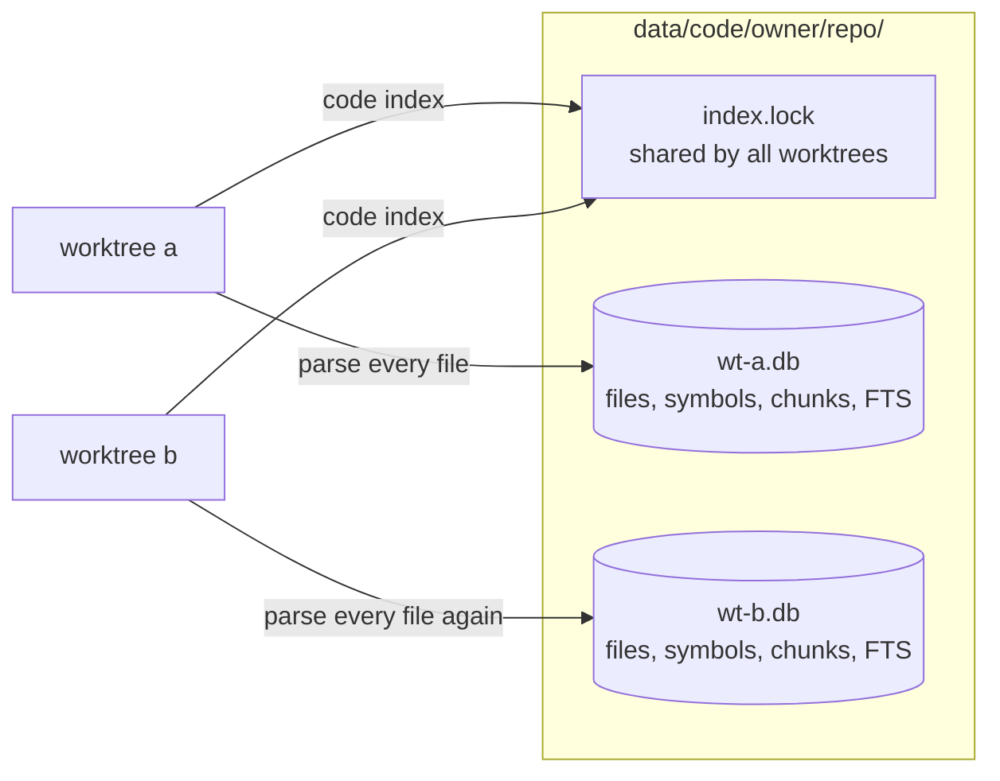
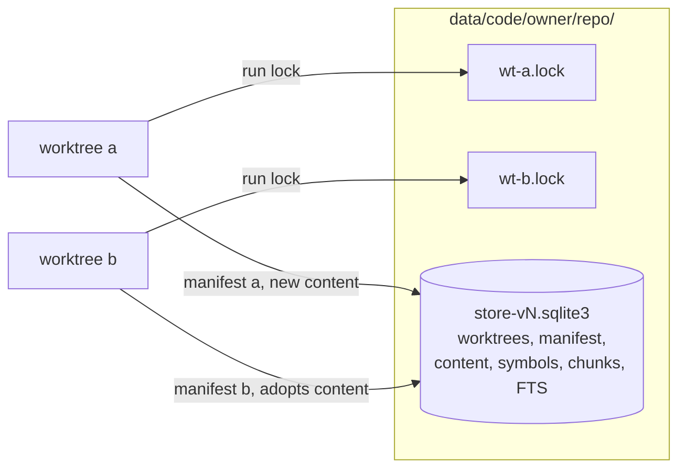
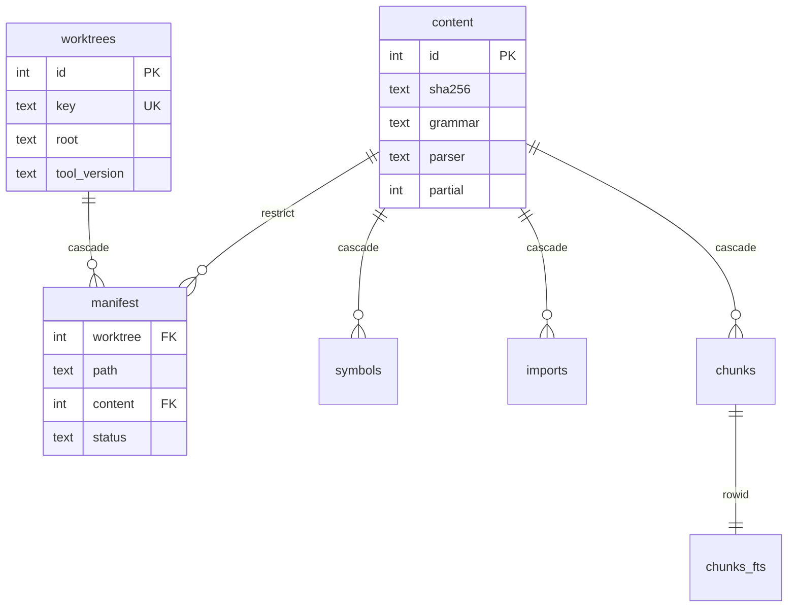
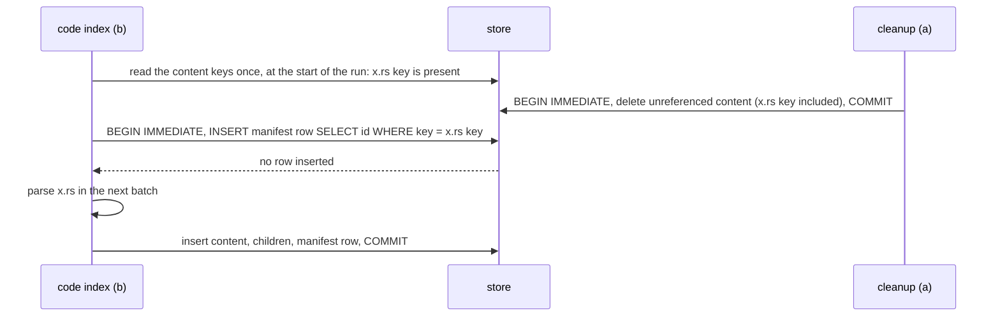

# ADR-0056: Share One Code Index Across the Worktrees of a Repository

- **Status:** Accepted
- **Date created:** 2026-10-27
- **Date modified:** 2026-10-30
- **Amends:** [ADR 0026](0026-local-code-index-in-the-binary.md) decision 2 (index location). It replaces "Each worktree has its own index", the rule that a schema mismatch deletes the file, and the rule that index files stay when a worktree is deleted.
- **Relates to:** [ADR 0012](0012-unify-state-under-config-playbook.md) (repo and worktree tiers), [ADR 0016](0016-migration-framework.md) and [ADR 0046](0046-migrations-by-release-version.md) (the migration registry), [ADR 0048](0048-collector-daemon-started-by-commands.md) (no PreToolUse or PostToolUse hook starts a process)

## Context

`playbook code` keeps one SQLite index per git worktree at `<data>/code/<owner>/<repo>/<worktree-id>.db` (`crates/data/src/lib.rs:39-47`). ADR 0026 put it under `repos/.../<worktree-id>/code/index.sqlite3` (`0026:40`). #918 moved it into the data folder without an ADR, and `host::index_db` (`crates/code/src/host.rs:36-48`) still moves the old file on first use.

Since #1377, the plugin tells every session to run `playbook code status` before a code question and `playbook code index` when the index is missing or stale. `/playbook:implement` works in one worktree per Work Unit, and this repo has 57 worktrees today (`git worktree list`). Each new worktree starts with no index, and its first query has to build one from nothing.

Measured on this repo on 2026-10-27:

| What | Value | Source |
| --- | --- | --- |
| One index | 11.8 MB, 1,038 files, 15,054 symbols, 5,236 chunks | `sqlite3` counts on the main checkout's db |
| Distinct content in one worktree | 1,018 sha256 values for 1,038 files | same db |
| FTS share of the file | 4.26 MB | `dbstat` |
| Full index run | 0.78 s | `plans/code-search-wiring.md`, Out of Scope, 2026-10-26 |
| Hash pass alone (`code status`) | 0.05 s to 0.08 s | same plan |
| Worktrees with an index | 1 of 57 | `ls <data>/code/pragmatic-engineer/playbook/` |
| Committed files across all 57 worktrees | 57,473 files, 2,530 distinct blob ids (ratio 0.044) | M1 of the blueprint, `git ls-tree -r HEAD` in every worktree, 2026-10-28 |

Most worktrees of one repo hold nearly the same files: 57,473 committed files across the 57 worktrees hold only 2,530 distinct contents. A branch for one Work Unit changes a handful of files and leaves the other 1,000 identical. With one index per worktree, each of those files is parsed and stored again in every worktree.

The parse output of a file depends only on its bytes and its grammar. Every extractor takes `(root, source)` and no path (`crates/code/src/lang/rust.rs:23`, `python.rs:23`, `typescript.rs:26`, `go.rs:24`, `lang/mod.rs:266`). Only the grammar comes from the path: `Lang::for_path` picks it by extension, and `.ts` and `.tsx` use different grammars while both are stored as `typescript` (`lang/mod.rs:38-60`). The indexer already hashes every file with sha256 on every run (`crates/code/src/index.rs:267`).

The current layout has four properties that a shared index must not break:

1. Results stay per worktree. A query in one worktree returns only that worktree's paths. ADR 0012 keeps gate state per worktree because a shared `plan_slug` gives false verdicts (`0012:30`). The memory fact `data-folder-worktree-scoped-databases` extends this to "must not share a code index". The goal there is isolated results, and a per-worktree manifest keeps that goal.
2. A schema mismatch or a corrupt file in `Index` mode deletes the file and rebuilds it (`crates/code/src/db.rs:171-182`), and `--rebuild` deletes it too (`index.rs:583-586`). For one shared file, a worktree on a newer build would delete the index that every older worktree uses.
3. The run lock is `index.lock` beside the db (`index.rs:546-549`). The folder is per repo. Every worktree of the repo already shares this lock. The freshness plan (`plans/code-index-background-freshness.md`, R8) makes it per worktree, because a 300 ms session hook cannot wait for a full run in a sibling worktree.
4. A path that cannot be read (a stat or read error) after it had a row keeps its old sha256 and child rows (`index.rs:455-465`). Only a new path gets an empty sha256 and no children.

## Decision Drivers

- Each new worktree pays a full parse (0.78 s here) and about 12 MB of disk for content the repo already has. Today 56 of the 57 worktrees have no index.
- The hooks of the freshness plan cannot build a first index inside their 300 ms budget (plan, Non-goals). A worktree whose files are already parsed somewhere else needs only the hash pass (0.05 s to 0.08 s) to get a full index.
- Results must stay per worktree (property 1).
- Two playbook builds in two worktrees must not delete or corrupt each other's index (property 2).
- A hook in one worktree waits for another worktree's write only up to its own bounded timeout, and skips its refresh when the store stays busy (property 3). The longest write transaction of an index run is bounded (decisions 4 and 5).
- No new dependency. The sha256 the indexer already computes is the content key (`playbook_common::hash::sha256_hex`, `crates/common/src/hash.rs:9`). A git blob id needs SHA-1, which no crate in `Cargo.lock` provides, and it misses untracked and dirty files.

## Considered Alternatives

### A. Keep one index per worktree (effort: none)

- Nothing changes. Each worktree builds its own full index on its first `code index`.
- Trade-offs: no work and no risk. Every worktree pays the full parse and about 12 MB. The hook non-goal stays. A fresh worktree has no index until someone runs `code index`.

### B. Seed a new worktree's index from a sibling (effort: S)

- When a worktree has no index, `code index` copies a sibling's db with `VACUUM INTO`, then runs an incremental pass that reparses only the files whose sha256 differs.
- Trade-offs: small change, no schema change, and the first index costs a copy plus the changed files. With a rule that seeds only from a sibling of the same `SCHEMA_VERSION`, it does not break property 2. It saves the 0.78 s parse once per new worktree. Disk stays at about 12 MB per worktree, and after creation the same file changed the same way in two worktrees is parsed twice. A variant attaches a sibling db and copies rows by sha256. It has the same costs.
- What C buys over B: one copy of each distinct file per repo (disk grows with the changed files only, once many worktrees are indexed), and no parse for content any sibling already holds, at any time. What C costs over B: a join on every query, one file for all worktrees, and a cleanup. The disk and join figures are not measured yet. Gate M2 (before WU-0 merges) and gate M3 (before WU-2 merges) measure them, each with a stop threshold. WU-5 runs both again.

### C. One store per repo: content keyed by (sha256, grammar, parser) and per-worktree manifests in the same file (effort: L)

- One SQLite file per repo holds content rows keyed by sha256, grammar and parser version, the symbols, imports and chunks of each content row, and one manifest per worktree that maps each path to a content row.
- Trade-offs: each distinct file is parsed and stored once per repo and parser version. A new worktree needs only the hash pass for content the store has. Every query gains one join through the manifest. Foreign keys inside one file keep manifests and content consistent without a lock. One file now serves every worktree. A corrupt store costs every worktree a rebuild, and the store needs its own cleanup of content no manifest uses.

### D. A shared content db plus one manifest db per worktree, joined with ATTACH (effort: L)

- Content goes into one file per repo. Each worktree keeps a small manifest db at today's `<worktree-id>.db` path and ATTACHes the content db on open.
- Trade-offs: worktree removal keeps deleting one file, as `remove_worktree_dbs` does today (`crates/data/src/lib.rs:54-73`). SQLite enforces no foreign key across attached files. A cleanup of unused content must open every manifest file of the repo, and a manifest row can point at content that a cleanup in another process just deleted. Every query opens two files, and the two files need two schema versions that must agree.

### E. Key content by git blob id (effort: M)

- `git ls-files -s` gives a blob id per tracked path, used as the content key.
- Trade-offs: no hashing for clean tracked files. It needs a SHA-1 dependency to hash dirty and untracked files, and `ls-files -s` reports the staged blob, which differs from the bytes on disk for a modified file. The indexer reads and hashes every file anyway (`index.rs:267`).

## Decision

We choose C. The parts below are the decision. The blueprint holds the work.

### 1. One store file per repository

The store is `<data>/code/<owner>/<repo>/store-v<N>.sqlite3`, where `N` is `db::SCHEMA_VERSION` (`crates/code/src/db.rs:16`). The `.sqlite3` extension keeps `orphan_dbs` from flagging it, since that function lists only `*.db` files (`crates/data/src/lib.rs:92-97`). The doctor size total counts every file in the folder (`list_files`, `crates/data/src/migrate.rs:659-674`, called at `crates/cli/src/doctor/check.rs:1183`) and includes the store. Two clones of one repo resolve to the same `<owner>/<repo>` and share the store. That is safe because content is keyed by its bytes and each worktree, from any clone, has its own manifest.

### 2. Tables

- `worktrees`: one row per worktree, with `id INTEGER PRIMARY KEY AUTOINCREMENT` and a unique `key`, the worktree id (`playbook_common::paths::worktree_id`). It holds `created_at`, the root path, the tool version and the meta values that are per worktree today (`last_run_started`, `last_run_completed`, `index.rs:589-592` and `:711-715`, and the freshness plan's `refresh_generation`).
- `content`: one row per `(sha256, grammar, parser)`, unique, with `id INTEGER PRIMARY KEY AUTOINCREMENT` so an id is never reused after a delete. `grammar` is the `Lang` variant (`tsx` apart from `typescript`), or `text` for a file with no grammar. `parser` joins three parts. The first is the tool version (`host::tool_version`). The second is `EXTRACTOR_REVISION`, a constant in `crates/code/src/lang/mod.rs` that a change to any extractor, to `fts_body` or to chunking must bump. The third is a hash of the `tree-sitter*` dependency lines of `crates/code/Cargo.toml`, read with `include_str!` (the grammars are pinned with `=`, and the crate has `publish = false`). A grammar bump changes the key without a manual step. A debug build replaces the second part with a hash of the extractor sources (one `include_str!` per extractor file under `lang/` and one for `index.rs`). Two debug builds with different extractors never share rows. `partial` is the status of the parse: it is 1 when the tree had errors or the file is not valid UTF-8 (`index.rs:303-307`), and an adopted file takes the status `partial` from it.
- `manifest`: one row per `(worktree, path)`, with `content` nullable, `lang`, `sha256`, `size`, `mtime_ns`, `status` (`ok`, `partial`, `failed`, `skipped`) and `error`. `worktree` references `worktrees` with `ON DELETE CASCADE`. `content` references `content` with `ON DELETE RESTRICT`. The primary key is `(worktree, path)`.
- Column types, as `STRICT` requires: ids, `worktree`, `content`, `size`, `mtime_ns`, `created_at`, `last_run_*` and `partial` are `INTEGER`. `key`, `root`, `tool_version`, `sha256`, `grammar`, `parser`, `path`, `lang`, `status` and `error` are `TEXT`. The child tables keep their column types from `db.rs:53-108`.
- `symbols`, `imports` and `chunks` reference `content` with `ON DELETE CASCADE`, in place of `files`. `chunks_fts` keeps its contentless layout and `rowid = chunks.id` (`db.rs:96-108`). `AUTOINCREMENT` keeps chunk ids unique in the store.
- Indexes: `manifest_content` on `manifest(content, worktree)`, which the `RESTRICT` check, the repoint check and the cleanup query need to avoid scanning every worktree's manifest, and `symbols_content`, `imports_content` and `chunks_content`, as `symbols_file`, `imports_file` and `chunks_file` are today (`db.rs:87,94,102`). The tables are `STRICT` (SQLite 3.43 or later: `STRICT` needs 3.37 and `contentless_delete` needs 3.43; every crate builds the bundled SQLite, and a unit test pins `sqlite_version()`). A wrong type fails at insert. Every connection sets `foreign_keys = ON` (`db.rs:225`). The store is created with `auto_vacuum = INCREMENTAL`, set before `journal_mode = WAL` because the pragma has no effect once the header is written, and each connection sets `journal_size_limit` to `WAL_SIZE_LIMIT` (64 MiB). After creating the schema the creator reads `PRAGMA auto_vacuum` back and runs `VACUUM` on the still-empty store if it is not 2.

The `files` table is gone. A connection that reads the index (`Query` mode, and the reads of a run) creates TEMP VIEWs for its worktree, after the worktree's row is final (`--rebuild` deletes and inserts the row and gets a new id). A view cannot bind parameters. The integer `worktrees.id` of the worktree's row is written into the view text. `files` is the worktree's manifest rows `LEFT JOIN`ed with their content, with the columns of today's table (`id`, `path`, `lang`, `sha256`, `size`, `mtime_ns`, `status`, `error`) plus `content` and `parser`. Its `id` is the content id, or a negative number from the manifest rowid for a path with no content. `symbols`, `imports` and `chunks` are views with the same names and columns as today, each with `file_id` set to the content id and restricted to the content that `files` lists. SQLite resolves an unqualified table name in the temp schema first. The query modules keep their SQL (`s.file_id = f.id` still joins), and `term_weights` (`context.rs:323-334`), which reads `symbols` with no join, is rewritten to join `files` (the `symbols` view lists each content row once, and today's count is per path). The run's reads (the unchanged check, `load_existing`) use the writer connection, which does not create the child views. A writer connection (the index batches) does not create the three child views, and reads and writes the real tables. A unit test checks both kinds of connection, and a source test checks that the query modules never name `manifest`. A failed path that had a row keeps its old `content`, as it keeps its children today (property 4). A failed row counts as a reference.

The parser key reuses content only from a build with the same key. A fresh worktree therefore never adopts output of a different extractor, as today. The unchanged check (`index.rs:270-281`) also compares the parser of the manifest row's content with the run's parser. A mismatch counts as a changed file for `code index`, which reparses or adopts it. Queries and hook refreshes serve a row whatever its parser, and a hook refresh touches only its dirty paths. Two builds that alternate in one worktree therefore make `code index` reparse each time, and nothing else. The revision is a manual step, as `SCHEMA_VERSION` is today, and a unit test pins the extractor, chunk and FTS body output of one fixture per language, with the revision beside it.

### 3. A build does not delete another build's store

A different schema version is a different file name. A build opens only the store of its own version. Two builds in two worktrees each use their own store. An older build keeps using its per-worktree `<worktree-id>.db` file. The upgrade in decision 8 deletes those files once, and an older build that runs later builds its file again.

A worktree must not unlink a store that a sibling uses. The lock file is `store-v<N>.lock` beside the store, one per version. In `Index` mode a missing file, a zero-length file or a file with `user_version` 0 means "create", not "damaged". Creation takes `BEGIN IMMEDIATE` on the file, checks `user_version` again under it and writes the schema only if it is still 0. Two cold-start runs serialize on SQLite's write lock, and the second finds the finished schema. A run, a hook refresh and a query each hold a shared lock on it for as long as they use the store (`try_lock_shared`, released explicitly on drop). A query that finds the lock exclusive polls `LOCK_POLL_TRIES` (5) times, `LOCK_POLL_MS` (10 ms) apart, then returns "the index is being rebuilt; try again". Only recovery takes the exclusive lock, in this order on one open handle: release the shared lock, `try_lock` exclusive, open the store again and check it under the lock, delete and recreate it only if it is still damaged, create the schema, then release the exclusive lock and take the shared lock again. A sibling that recovered first leaves a healthy store, which the second process finds in its check and does not delete. A sibling that takes the exclusive lock in the gap also finds a healthy store. The exclusive lock is therefore held only for the recovery, and a run does not block siblings. A delete removes the `-wal` file, then the `-shm` file, then the main file. A failure part way cannot leave a stale WAL beside a new database. When the exclusive lock is not available, the run fails with "another worktree is using the index; try again", the store path, and the remedy: stop other playbook sessions that use this repo, or delete the store files. It deletes nothing. `Query` mode never deletes anything (`db.rs:20-28`), and a zero-length file or a store with `user_version` 0 reads as `Missing` without any write, because the creator makes the file before it writes the header. On Windows an open store file cannot be deleted. Recovery fails with that error while any process uses the file, and it is not retried within the run.

### 4. Locks: one run lock per worktree, SQLite for the shared rows

The run lock becomes `<worktree-id>.lock` beside the store. It guards that worktree's manifest, as R8 of the freshness plan intends. Writes to shared rows need no lock of ours:

- Parsing happens outside any transaction, as today. Workers hold no database handle. The run reads the set of content keys once at its start. That set only decides which files to parse. It is a hint and never carries an id.
- Every write transaction is `BEGIN IMMEDIATE` (`TransactionBehavior::Immediate`), begun through one helper, `db::write_tx`: index batches, `remove_unlisted` deletes, repoint deletes, cleanup chunks, `--rebuild` rows and `forget_worktree`. A deferred transaction that reads and then writes gets `SQLITE_BUSY_SNAPSHOT` when a sibling commits in between, and the busy timeout does not retry that error. Each batch is one such transaction. For a parsed file it inserts content with `INSERT ... ON CONFLICT DO NOTHING` on the unique key, resolves the id by key, writes children only for a new content row, then writes the manifest row.
- For a file the hint marked as adopted, the manifest row is written with `INSERT INTO manifest(..., content) SELECT ..., id FROM content WHERE sha256 = ? AND grammar = ? AND parser = ? ON CONFLICT(worktree, path) DO UPDATE SET content = excluded.content, ...` in the same transaction. When it inserts no row, a cleanup deleted that content after the run started. The run parses the file in the next batch. When the statement replaced an existing manifest row, the same transaction deletes the old content row if no manifest references it (FTS rows first), as a repoint does.
- The `ON DELETE RESTRICT` foreign key and the `AUTOINCREMENT` id are second guards. Neither is the only protection against a manifest row pointing at the wrong content.

SQLite serializes write transactions on the file. A batch holds the write lock only for its inserts (200 files at most, `Options::batch_size`). A hook opens the store with its own bounded timeout (S32 of the freshness plan) and skips its refresh when the store stays busy. The cleanup in decision 5 runs in bounded chunks. The longest write transaction in any run is one batch, one cleanup chunk or one `incremental_vacuum` step of at most `VACUUM_PAGES` pages. A batch that gets `SQLITE_BUSY` at `BEGIN IMMEDIATE` (or at `COMMIT`) after the 5,000 ms `BUSY_TIMEOUT` (`db.rs:18`) is retried from `BEGIN` `BATCH_RETRIES` (3) times, because its outcomes are in memory. A fourth failure fails the run.

### 5. Cleanup

- `remove_unlisted` (`index.rs:719-745`) deletes manifest rows only.
- `playbook worktree` removal (`remove_data_of`, `crates/cli/src/worktree/mod.rs:287-296`) also calls `forget_worktree`, which deletes the removed worktree's `worktrees` row and its `<worktree-id>.lock`, also when no store exists. The cascade deletes the manifest. It opens the store in a maintenance mode: it never creates or deletes the store, sets `foreign_keys = ON`, holds the shared store lock, uses a busy timeout of `FORGET_BUSY_MS` (250 ms), checks the path segments as `remove_worktree_dbs` does (`crates/data/src/lib.rs:58`), and ignores a failure of the row delete, because the dead-root rule below removes the row later.
- When a refresh or a run points a manifest row at new content (a file was edited), the same transaction deletes the old content row if no manifest references it any more (FTS rows first, as `clear_children` does today). Hooks run this step too. Edits leave no garbage behind.
- At the end of each `playbook code index` run, a loop of short transactions does the rest. A read-only check (`SELECT EXISTS ...`) runs first. A run with nothing to clean does not take the write lock. Each transaction handles at most `CLEANUP_CHUNK` content rows (50). It selects those ids once into a temporary table. The FTS delete and the content delete then act on the same rows. The work per transaction stays small even for a file with hundreds of chunks. It deletes dead `worktrees` rows one at a time (a dead row's manifest rows go first, in chunks of at most `CLEANUP_CHUNK`, then the row), then content rows that no manifest references, with `DELETE FROM content WHERE id IN (SELECT id FROM temp.cleanup_ids)` after the FTS rows of those chunks are deleted from the same temporary table in the same transaction. A `worktrees` row is dead when `Path::try_exists` on its root returns `Ok(false)` and the later of its `last_run_completed` and `created_at` is older than `DEAD_ROOT_GRACE` (7 days). An error from `try_exists`, such as a permission error, keeps the row. A volume that stays unmounted for more than the grace period reads as a missing root and drops the row. The next `code index` in that worktree builds it again, because the index is a cache. The loop also deletes the `<worktree-id>.lock` file of each dropped row (after the `safe_segment` check on the key, and only when an exclusive `try_lock` on it succeeds), and runs `PRAGMA incremental_vacuum(VACUUM_PAGES)` (1,000 pages) so the file shrinks after churn. A delete that fails (on Windows, a file another process holds open) is skipped for that file and does not mark the loop as skipped. The run ends with a passive WAL checkpoint. Hooks never run this loop.
- The same loop deletes the files of older store versions (`store-v<M>.sqlite3` with `M` below the current version, with their `-wal` and `-shm`, and `store-v<M>.lock`) that no process modified for `STALE_STORE_GRACE` (30 days) and whose `store-v<M>.lock` an exclusive `try_lock` can take, comparing versions as numbers. An older build that indexes or refreshes keeps its file fresh. An older build that only queries does not, and it rebuilds on its next `code index`.
- A failure in this loop (a busy store, a constraint error) stops the loop and is reported as `cleanup: skipped` in the report. It never fails the run. The run's own writes are already committed, and the next run retries.
- `--rebuild` has one meaning for a healthy store: it rebuilds this worktree only. It deletes the `worktrees` row, ignores the adoption hint, parses every file the worktree lists, and replaces the children of each content row it reaches in one transaction per row. A replacement is by key: same bytes, same grammar, same parser. A sibling sees different rows only when the stored rows were wrong. `--rebuild` first opens the store and runs `PRAGMA quick_check(1)` and the FTS5 `integrity-check` command on `chunks_fts`. When the open or the check fails, the store is damaged, and `--rebuild` recovers it as decision 3 describes: it recreates the whole store and then indexes this worktree, and other worktrees read as missing until they index again. When the store is damaged and a sibling holds the shared lock, it exits 1 with the store path and the remedy, and changes nothing. A `SQLITE_CORRUPT` or `SQLITE_NOTADB` error (the primary code, which covers the extended `SQLITE_CORRUPT_VTAB`) raised inside any query or run write is mapped to `NeedsRebuild` with the `--rebuild` hint, as a bad header is today. The report says whether the store was rebuilt or only the worktree.

### 6. Queries

Each query first checks that the store file exists and has a schema. When it does not, the result is `Missing` and the query creates nothing, not even the lock file. Otherwise it takes the shared store lock, opens the store in `Query` mode and resolves the current worktree's row once. When the file is absent, or the file has no row for this worktree, the result is `DbError::Missing` ("no index yet; run `playbook code index`"), and `code status` reports the index as missing. A new worktree of a repo whose store exists therefore behaves like a repo with no index. Otherwise the query reads the scoped `files` view and joins the child tables on `content`. That covers `search` (`crates/code/src/search.rs:225-260`) and its literal scan (`search.rs:352-381`), `ranked` (`ranked.rs:49-56`, `:130-147`), `refs` (`refs.rs:87-91`), `context` (`context.rs:141-144`, `:192-206`, `:291-292`) and `term_weights` (`context.rs:323-334`), which has no join today. Two paths with the same content both appear, as they do today.

bm25 statistics in `chunks_fts` become store-wide. Scores can differ slightly from a per-worktree index. The blueprint adds a ranking test with two worktrees.

### 7. Command output

`code status` and `code index` keep their JSON fields. `db_bytes` is the store file size, which every worktree shares. `last_run_*` come from the worktree's row. `code index` adds `reused`, the count of adopted files, `cleanup` (`"done"` or `"skipped"`) and `scope` (`"worktree"` or `"store"`, set to `"store"` when `--rebuild` recreated the store). The text output prints one line for each: `reused: N`, `cleanup: skipped` (only when skipped) and `rebuilt: worktree only` or `rebuilt: store`. The envelope path is the store path.

### 8. Upgrade

An `Auto`, `Owned` registry entry in `crates/cli/src/init/migrate.rs`, with `since: "next"` (ADR 0046), deletes the per-worktree `*.db` code files and their `-wal` and `-shm` files in `<data>/code/` (it first takes an exclusive `try_lock` on the old repo-wide `index.lock` and skips the folder while an older build holds it), the old repo-wide `index.lock` there, and the old `repos/.../code/index.sqlite3` files whose `PRAGMA user_version` is below the current schema version. They are a cache. The next `code index` rebuilds into the store. `host::index_db` stops moving the old file. `WORKTREE_KINDS` keeps `code`. Files that an older build writes later are still removed with their worktree and listed by `doctor`.

When `scoped_db` finds no safe data path for the repo, `host::index_db` keeps returning the state folder path (`host.rs:36-40`). That file is then a store with one `worktrees` row and no other worktree uses it. It uses the same schema, and a different schema version still deletes and rebuilds it, as today, because no sibling depends on it. Its lock file is `<state folder>/code/index.lock`, named by a separate fallback rule (`fallback_lock_path`) because that store has no worktree key in its file name. The migration leaves it alone while its `user_version` is current. This amends the "No ... migration" non-goal of the freshness plan: the migration above is the one it allows.

### Why the other alternatives lose

- **A** keeps the full parse and the 12 MB per worktree, and keeps fresh worktrees without an index.
- **B** saves the parse once per new worktree and saves no disk. After creation it parses a file again in every worktree that changes it the same way. With the same-schema rule it keeps property 2. The reason to prefer C is then disk and repeated parsing, which are not measured yet. Gates M2 and M3 measure them and stop the work if C does not stay under the stated thresholds. C is accepted on the condition that both gates pass. If either fails, B is the fallback.
- **D** has no foreign key across files. Cleanup would need to open every manifest file and could still race a writer in another process. C gets the same isolation with one file and constraints SQLite enforces.
- **E** needs a SHA-1 dependency and still hashes dirty and untracked files. The sha256 pass already exists.

## Consequences

- A new worktree whose files the store already has gets a full index for the cost of the hash pass. The freshness plan's reason that hooks cannot build a first index (Non-goals) no longer holds on cost. The non-goal stays for now (Resolved questions, 1).
- Disk for N worktrees of one repo is one store plus the content that differs, in place of N full indexes. This is not measured yet. M1 measured the share of identical files across the real worktrees (ratio 0.044). The blueprint measures a store with diverging worktrees at the end of WU-2.
- Every query gains one join through the scoped view. The blueprint's benchmark must show `code context`, `code search` and `code refs` within 10% of today on this repo, on a store that holds several diverging worktrees.
- One corrupt store costs every worktree of the repo a rebuild. `code index --rebuild` is the repair: it rebuilds this worktree, and it recreates the whole store only when the store is damaged. Other worktrees then read as missing until they index again.
- The freshness plan changes in nine Segments: eight are re-based (S25, S27 to S29 and S32 to S35), and S31 is dropped. S24, S26 and S30 stay as written. The blueprint lists each change.
- Every schema bump leaves the old store file until `STALE_STORE_GRACE` has passed.
- ADR 0026's Status line says decision 2 is amended here. The note also records that the index moved to the data folder (#918) and that Go is indexed (`lang/mod.rs:46`, ADR 0026 lists five grammars at `:32`). The memory fact `data-folder-worktree-scoped-databases` is updated to say that worktrees share content and keep separate manifests.

## Architecture Diagrams

Current state:

Proposed state:

Tables:

A run in worktree b while a cleanup runs in worktree a:

## Resolved questions

The maintainer answered both on 2026-10-27.

1. Should `session-init` build a first manifest for a worktree when the store already has content? It would fit the 300 ms budget for this repo. No: hooks keep the freshness plan's non-goal and build no index. The question comes back after S29's measurements.
2. Should `code status` report how much of the store a worktree uses? No, until someone asks.
