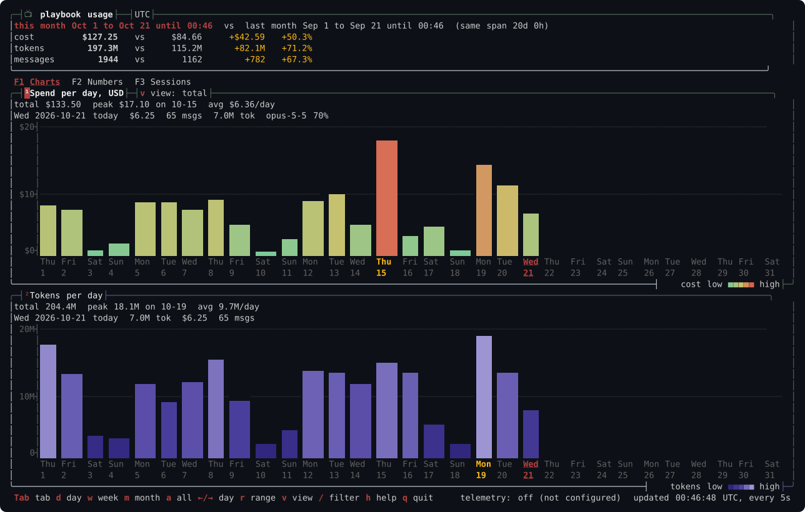

# pbtop, the usage dashboard on its own

`pbtop` is the Claude Code usage and cost dashboard as one small program, for a machine without playbook. With playbook installed you do not need it: `playbook usage` runs the same code.



The monthly view with sample data. Press `m` for this month, or run `pbtop --range month`.

Install it with either command:

```bash
brew install pragmatic-engineer/tap/pbtop
curl -fsSL https://raw.githubusercontent.com/pragmatic-engineer/playbook/main/install-pbtop.sh | sh
```

On Homebrew, `pbtop` is its own formula in the same tap. Read [Homebrew tap trust](00-install.md#homebrew-tap-trust) first. The full name records the trust. To install it by short name first, run `brew trust --formula pragmatic-engineer/tap/pbtop`.

Then run `pbtop`, `pbtop --summary` or `pbtop --json`.

The script checks the checksum of the `pbtop` archive and its build attestation when `gh` can check it, then installs `pbtop` into `~/.local/bin`. It needs `bash` and `curl`. The [install guide](00-install.md#optional-pbtop-alone) has the details and a route without `curl | sh`.

The code index has no standalone tool. It ships inside `playbook` as `playbook code`.

## Retired playbook-telemetry

The `playbook-telemetry` command and Homebrew formula are deprecated, and its old repository is archived. If you installed the formula, run `brew uninstall playbook-telemetry && brew install pragmatic-engineer/tap/pbtop`, or install playbook and use `playbook usage`. A script that calls `playbook-telemetry` should call `pbtop` with the same arguments.
